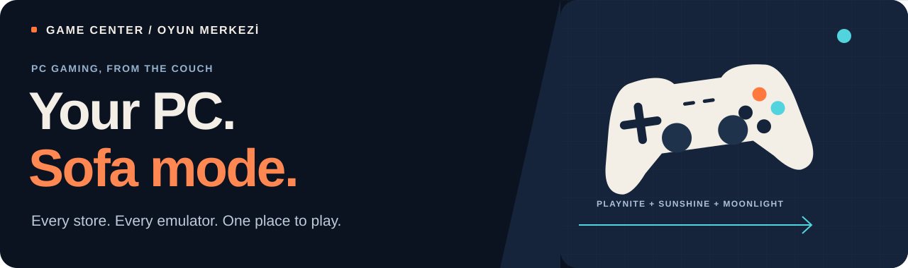
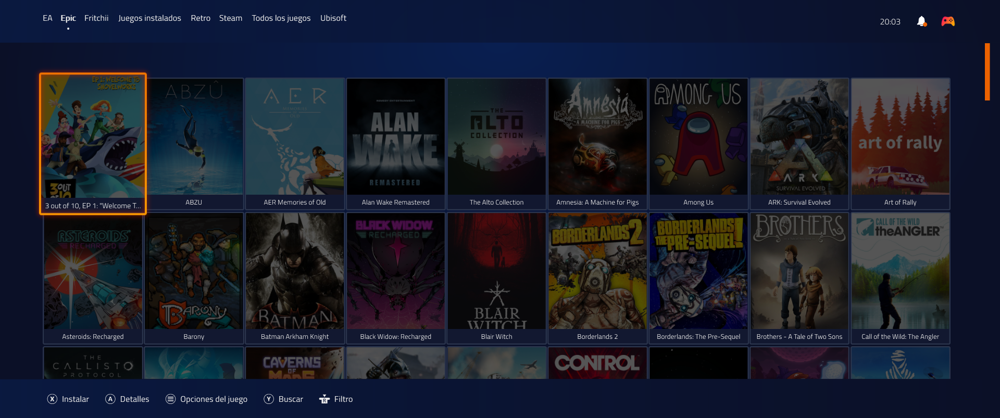
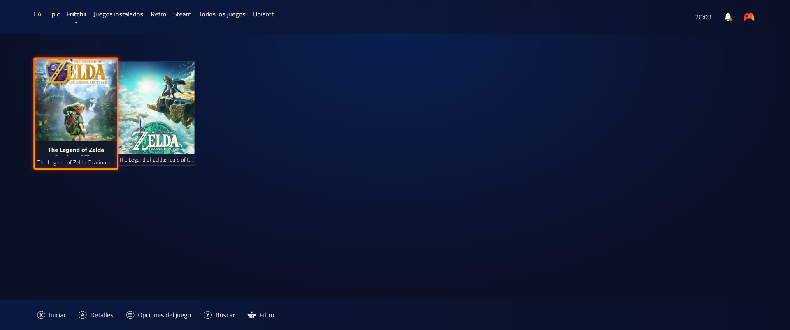
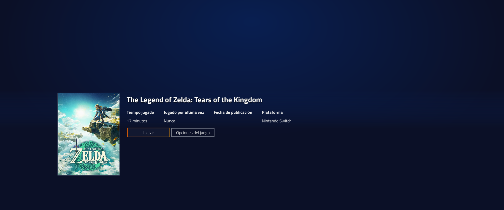
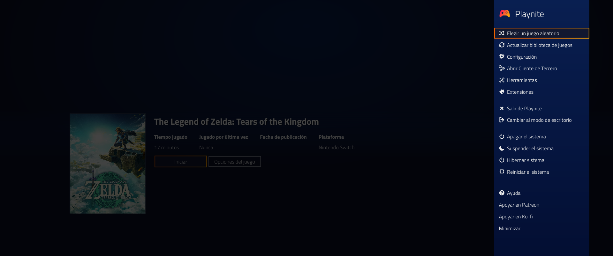
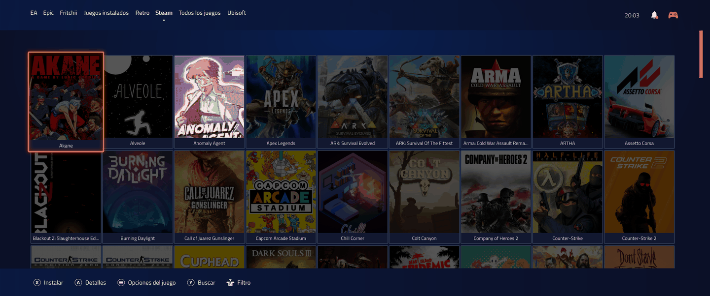
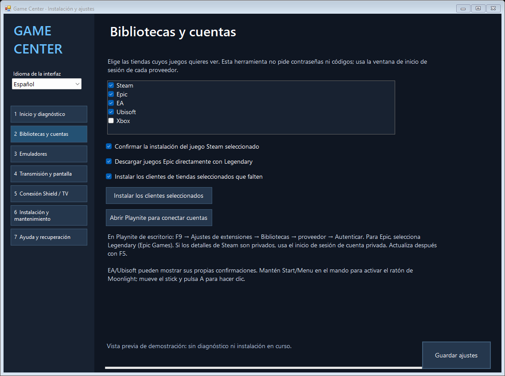
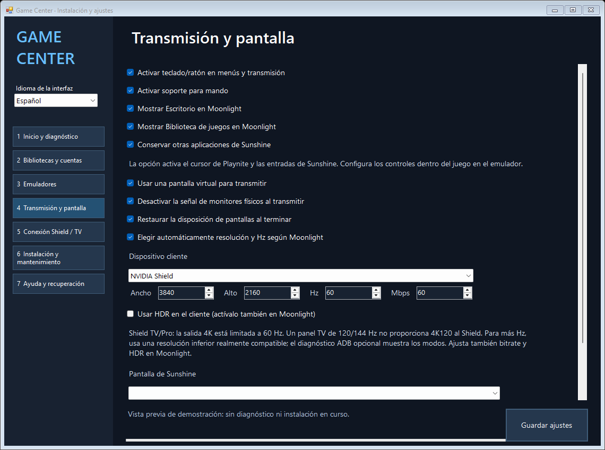
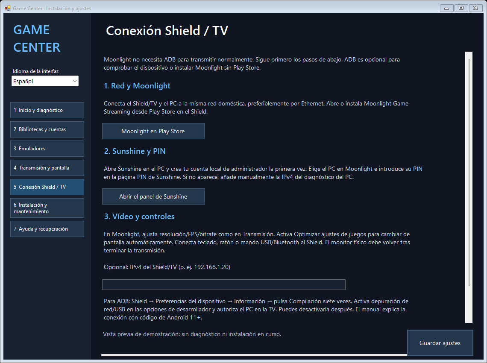
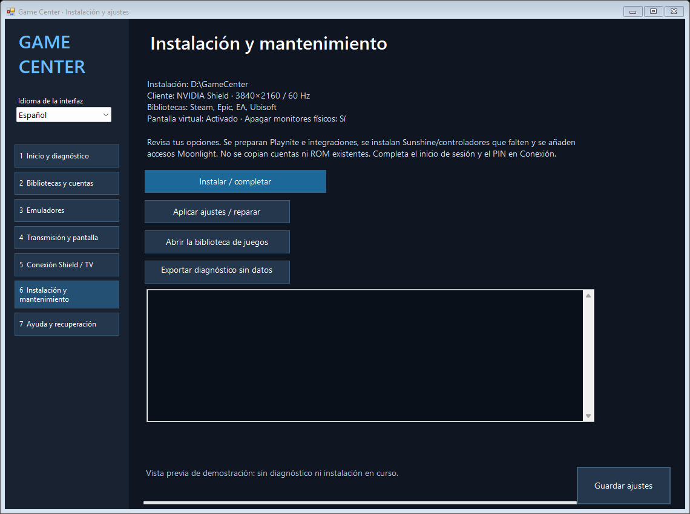

<a href="README.md">English</a> · <a href="README.tr.md">Türkçe</a> · <a href="README.fr.md">Français</a> · <a href="README.es.md"><b>Español</b></a>

<a href="https://github.com/ozi-dev/game-center/releases/latest"><b>Descargar para Windows</b></a> · <a href="docs/guides/es.md">Guía de instalación</a> · <a href="docs/CREDITS.md">Créditos</a>

# Tus juegos de PC, al alcance del sofá

**Game Center / Oyun Merkezi** es un asistente de configuración para Windows que reúne Playnite, Sunshine y Moonlight. Agrupa tus tiendas y emuladores locales en una biblioteca que puedes manejar con un mando y juega desde un televisor, NVIDIA Shield u otro cliente Moonlight.

**Playnite ofrece la interfaz de biblioteca; Sunshine y Moonlight realizan la transmisión.** Este proyecto añade instalación guiada, ajustes compartidos, importación del tiempo de juego, gestión de carátulas y recuperación de la configuración. Gracias a quienes mantienen esas herramientas.

## Funciones

| Función | Para qué sirve |
| --- | --- |
| Una biblioteca | Steam, Epic, EA, Ubisoft, Xbox opcional y juegos locales/emulados mediante Playnite. |
| Instalación desde el sofá | Legendary descarga juegos de Epic compatibles; un asistente confirma la instalación del juego de Steam seleccionado. Otros clientes pueden necesitar interacción. |
| Historial de emuladores | Importa registros compatibles de Fritchii/Lichii y RetroArch e intenta evitar contar dos veces las sesiones compartidas. |
| Carátulas | Icono disponible dentro de un NUP o archivo `.cover.png` / `.cover.jpg` junto al juego; metadatos de Playnite para el resto. |
| Controles | Mando, teclado/ratón y cursor visible. Las teclas dentro de cada juego se asignan en su emulador. |
| Pantalla | Pantalla virtual firmada opcional, resolución y frecuencia configurables, desactivación de la señal de monitores físicos durante la transmisión y restauración posterior. |
| Accesos en Moonlight | Biblioteca, escritorio o ambos, con opción de conservar otras aplicaciones de Sunshine. |
| Instalación y recuperación | Detección de componentes, copias de seguridad, restauración con detección de conflictos, diagnóstico sin datos personales y ADB opcional. |

## Primeros pasos

1. Descarga el ZIP de Windows x64 desde [Versiones](https://github.com/ozi-dev/game-center/releases/latest).
2. Extrae **todo el archivo** y abre **`Kurulum.exe`**.
3. Sigue las siete páginas: elige tiendas, añade emuladores y configura la transmisión y la pantalla.
4. Cierra Playnite y cualquier transmisión antes de aplicar los cambios. Acepta los permisos de administrador necesarios y reinicia cuando se solicite.
5. Inicia sesión en tus cuentas desde Playnite y confirma el PIN de Moonlight en Sunshine.
6. En Moonlight, abre **Biblioteca - Playnite** para la biblioteca o **Escritorio** para el escritorio.

Para cambiar opciones después: **Inicio → Oyun Merkezi → Ajustes de Game Center**. La [guía en español](docs/guides/es.md) explica la configuración y la solución de problemas.

**Idiomas:** el instalador, los ajustes y los mensajes admiten **inglés, turco, francés y español** en 2.1.0. Cambia el idioma en la barra lateral sin alterar rutas ni preferencias. La ayuda sin conexión sigue tu selección; aplicar los ajustes también selecciona ese idioma en Playnite.

## Capturas de pantalla

Capturas reales de Playnite a pantalla completa desde las cuentas y los emuladores del responsable, publicadas con su permiso. Son las vistas que se transmiten al televisor; no se usó un catálogo de demostración ni se inició ningún juego. Los títulos y las carátulas pertenecen a sus titulares.

| Biblioteca Epic | Juegos del emulador Fritchii |
| --- | --- |
|  |  |

| Detalles y tiempo de juego importado | Menú principal de Playnite |
| --- | --- |
|  |  |

**Navegación entre menús**

Una secuencia breve de las vistas reales de Steam, Epic, emulador, detalles y menú.

Las capturas del asistente usan rutas de ejemplo y su interfaz en español.

| Bibliotecas | Transmisión y pantalla |
| --- | --- |
|  |  |

| Shield / TV | Instalación y mantenimiento |
| --- | --- |
|  |  |

## Compatibilidad y límites

- Windows 10/11 Intel/AMD x64, .NET Framework 4.8, PowerShell 5.1, controladores GPU actuales y un codificador compatible con Sunshine. WinGet facilita la instalación de clientes y componentes Microsoft.
- Shield, Android TV/Google TV y otros clientes Moonlight. **ADB no es obligatorio para jugar.**
- En Shield, empieza con **4K60**. Un panel de TV de 120/144 Hz no hace que Shield emita a 4K120. Las frecuencias superiores dependen de la salida y la decodificación reales del cliente. [Especificaciones NVIDIA](https://www.nvidia.com/en-us/shield/shield-tv/).
- El propietario debe completar el inicio de sesión, la autenticación de dos factores, el PIN y los permisos del dispositivo. Algunas tiendas necesitan el modo ratón del mando.
- Importar tiempo anterior requiere un registro compatible y un identificador correcto. No se puede recuperar tiempo que nunca se registró.
- No se incluyen juegos, ROM, BIOS, firmware, claves, partidas guardadas ni parches de juegos. Los botones TOTK opcionales solo editan un mod local compatible ya instalado; no garantizan una cifra de FPS.

Se superaron 15 comprobaciones del núcleo, 45 del backend y 1941 de localización, pruebas de interfaz y una instalación limpia real de Playnite con importación. No se ha realizado una prueba física de Shield ni de todas las combinaciones de hardware. [Alcance de pruebas](docs/TESTING.md).

## Agradecimientos y apoyo

Gracias a [Playnite](https://github.com/JosefNemec/Playnite), [Sunshine](https://github.com/SunshineStream/Sunshine), [Moonlight](https://github.com/moonlight-stream/moonlight-android), [VirtualDrivers](https://github.com/VirtualDrivers/Virtual-Display-Driver), [Legendary](https://github.com/legendary-gl/legendary), hawkeye116477, Libretro, Nefarius, Igor Pavlov y los autores de las integraciones. Visita y apoya también sus proyectos. [Créditos y licencias](docs/CREDITS.md).

<!-- SUPPORT-LINK:START -->
Puedes ayudar con una estrella, informes de errores reproducibles, traducciones y mejoras del código. Añadiremos un enlace de apoyo económico cuando la cuenta del responsable esté activa. [Información de apoyo](docs/SUPPORT.md).
<!-- SUPPORT-LINK:END -->

[Contribuir](CONTRIBUTING.md) · [Compilar](docs/DEVELOPMENT.md) · [Informar de un error](https://github.com/ozi-dev/game-center/issues/new/choose)

El código de integración original usa la licencia **MIT**. Los componentes externos conservan sus licencias. [Avisos](THIRD-PARTY.md). Proyecto comunitario independiente de [ozi-dev](https://github.com/ozi-dev), sin afiliación con las tiendas o proyectos mencionados.
