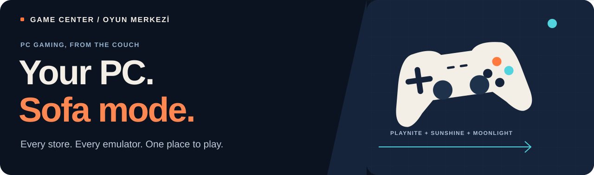
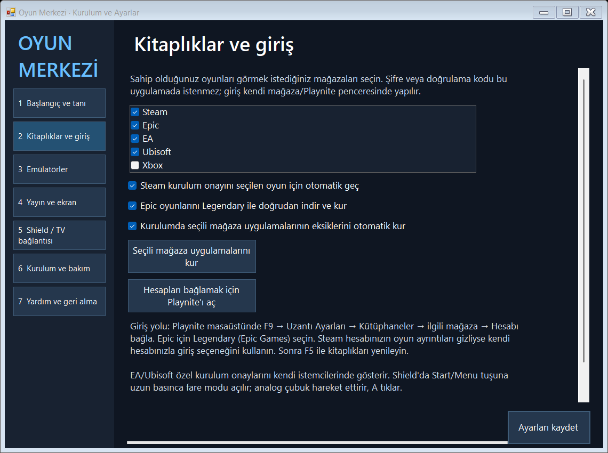
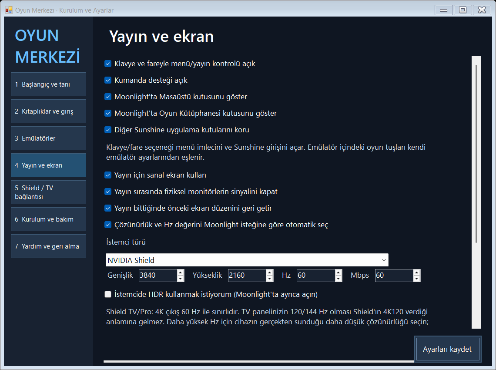
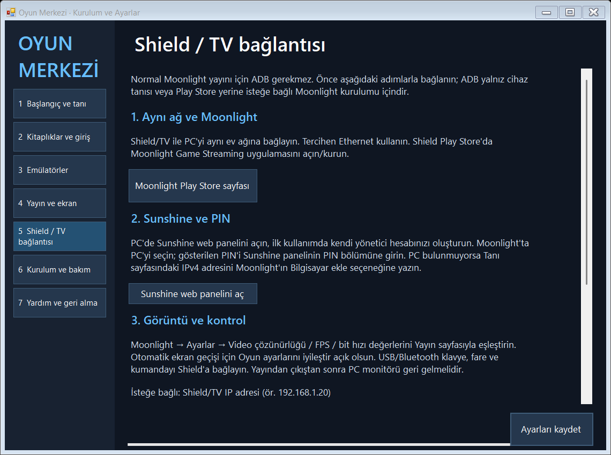
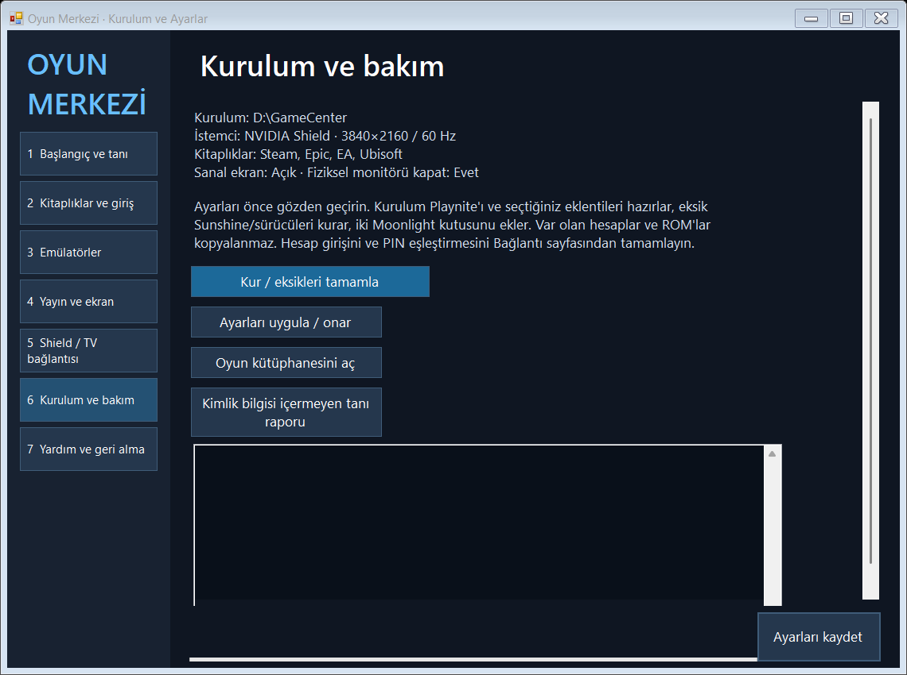

<a href="README.md">English</a> · <a href="README.tr.md">Türkçe</a> · <a href="README.fr.md"><b>Français</b></a> · <a href="README.es.md">Español</a>

<a href="https://github.com/ozi-dev/game-center/releases/latest"><b>Télécharger pour Windows</b></a> · <a href="docs/guides/fr.md">Guide d’installation</a> · <a href="docs/CREDITS.md">Remerciements</a>

# Vos jeux PC, accessibles depuis le canapé

**Game Center / Oyun Merkezi** est un assistant Windows qui réunit la configuration de Playnite, Sunshine et Moonlight. Retrouvez vos boutiques et émulateurs locaux dans une bibliothèque utilisable à la manette, puis jouez sur un téléviseur, un NVIDIA Shield ou un autre client Moonlight.

**Playnite fournit l’interface de bibliothèque ; Sunshine et Moonlight assurent le streaming.** Notre contribution porte sur l’installation guidée, les réglages communs, l’importation des durées de jeu, les jaquettes manquantes et les outils de récupération. Merci aux équipes de ces projets.

## Fonctionnalités

| Fonction | Utilité |
| --- | --- |
| Bibliothèque unifiée | Steam, Epic, EA, Ubisoft, Xbox en option et jeux locaux/émulés via Playnite. |
| Installation à distance | Téléchargements Epic compatibles via Legendary ; confirmation de la fenêtre d’installation du jeu Steam sélectionné. Les autres clients peuvent demander une intervention. |
| Historique des émulateurs | Importation des données Fritchii/Lichii compatibles et des journaux RetroArch ; protection contre le double comptage des sessions communes. |
| Jaquettes | Icône disponible dans un NUP ou fichier voisin `.cover.png` / `.cover.jpg` ; métadonnées Playnite pour les autres images. |
| Commandes | Manette, clavier/souris et curseur visible ; les touches en jeu se configurent dans l’émulateur. |
| Affichage | Écran virtuel signé en option, résolution/fréquence personnalisables, désactivation du signal des moniteurs physiques pendant le streaming et restauration ensuite. |
| Accès Moonlight | Bibliothèque, bureau ou les deux, avec possibilité de conserver les applications Sunshine existantes. |
| Installation et récupération | Détection des composants, sauvegardes, restauration prudente, diagnostic expurgé et ADB facultatif. |

## Installation rapide

1. Téléchargez le ZIP Windows x64 depuis les [versions publiées](https://github.com/ozi-dev/game-center/releases/latest).
2. Extrayez **toute l’archive**, puis ouvrez **`Kurulum.exe`**.
3. Suivez les sept pages : boutiques, émulateurs, streaming et écran.
4. Fermez Playnite et la session de streaming avant d’appliquer. Acceptez l’élévation Windows nécessaire ; redémarrez si demandé.
5. Connectez vos comptes dans Playnite, puis validez le PIN Moonlight dans Sunshine.
6. Dans Moonlight, choisissez **Oyun Kütüphanesi - Playnite** pour les jeux ou **Masaüstü - Desktop** pour le bureau.

Les réglages restent accessibles depuis **Démarrer → Oyun Merkezi → Oyun Merkezi Ayarları**. Le [guide français](docs/guides/fr.md) traduit les libellés importants.

**Langues :** les documents sont disponibles en anglais, turc, français et espagnol. L’interface de l’installateur et ses messages sont actuellement en turc ; les guides expliquent ses pages numérotées. L’interface multilingue complète n’est pas incluse dans la version 2.0.0.

## Captures d’écran

Captures réelles de l’assistant, avec des chemins d’exemple et sans comptes personnels. L’interface de la bibliothèque diffusée est le mode plein écran de Playnite.

| Boutiques | Streaming et écran |
| --- | --- |
|  |  |

| Shield / TV | Installation et maintenance |
| --- | --- |
|  |  |

## Compatibilité et limites

- Windows 10/11 Intel/AMD x64, .NET Framework 4.8, PowerShell 5.1, pilotes GPU récents et encodeur compatible Sunshine. WinGet facilite l’installation des clients et des bibliothèques Microsoft.
- Shield, Android TV/Google TV et autres clients Moonlight. **ADB n’est pas nécessaire pour jouer.**
- Sur Shield, commencez en **4K60**. Une dalle TV à 120/144 Hz ne permet pas au Shield de sortir en 4K120. Les modes supérieurs dépendent réellement du matériel. [Caractéristiques NVIDIA](https://www.nvidia.com/en-us/shield/shield-tv/).
- L’authentification, la double vérification, le PIN et les autorisations de l’appareil sont à effectuer par leur propriétaire. Certains jeux/clients nécessitent le mode souris de la manette.
- L’historique nécessite un journal compatible et un identifiant de jeu correct. Les durées jamais enregistrées ne peuvent pas être reconstituées.
- Aucun jeu, ROM, BIOS, firmware, clé, sauvegarde ou correctif de jeu n’est fourni. Les profils TOTK facultatifs modifient seulement un mod local compatible déjà installé ; aucun niveau de FPS n’est garanti.

15 vérifications du cœur et 45 du backend, des contrôles d’interface et un véritable test Playnite vierge/importation ont réussi. Le test physique sur Shield et toutes les combinaisons matérielles restent à effectuer. [Périmètre des tests](docs/TESTING.md).

## Remerciements et soutien

Merci aux équipes de [Playnite](https://github.com/JosefNemec/Playnite), [Sunshine](https://github.com/SunshineStream/Sunshine), [Moonlight](https://github.com/moonlight-stream/moonlight-android), [VirtualDrivers](https://github.com/VirtualDrivers/Virtual-Display-Driver), [Legendary](https://github.com/legendary-gl/legendary), à hawkeye116477, Libretro, Nefarius, Igor Pavlov et aux auteurs des intégrations. Vous pouvez aussi soutenir leurs projets. [Crédits et licences](docs/CREDITS.md).

<!-- SUPPORT-LINK:START -->
Une étoile, un rapport de bogue reproductible, une traduction ou une correction sont déjà une aide. Un lien de soutien financier sera ajouté après activation du compte du mainteneur. [Informations](docs/SUPPORT.md).
<!-- SUPPORT-LINK:END -->

[Contribuer](CONTRIBUTING.md) · [Compiler](docs/DEVELOPMENT.md) · [Signaler un problème](https://github.com/ozi-dev/game-center/issues/new/choose)

Le code d’intégration original est sous licence **MIT** ; les logiciels tiers gardent leurs licences. [Mentions](THIRD-PARTY.md). Projet communautaire indépendant de [ozi-dev](https://github.com/ozi-dev), sans affiliation avec les boutiques ou les projets cités.
