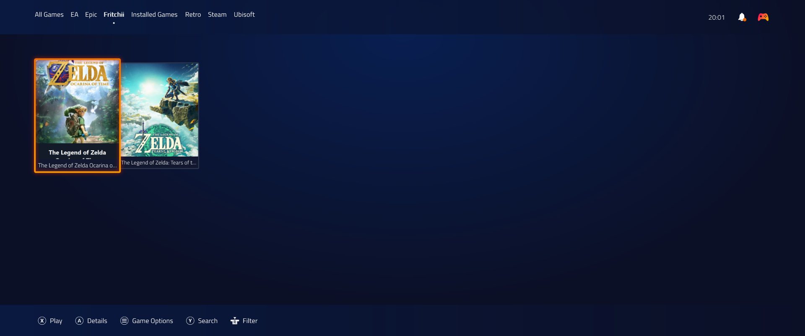
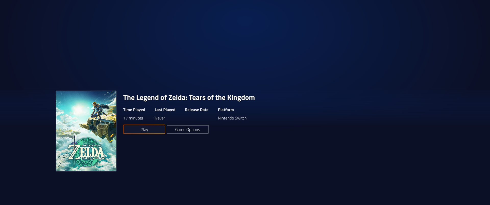
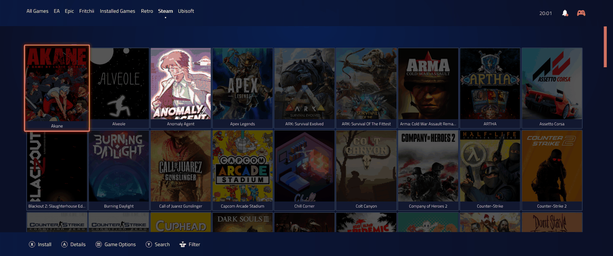
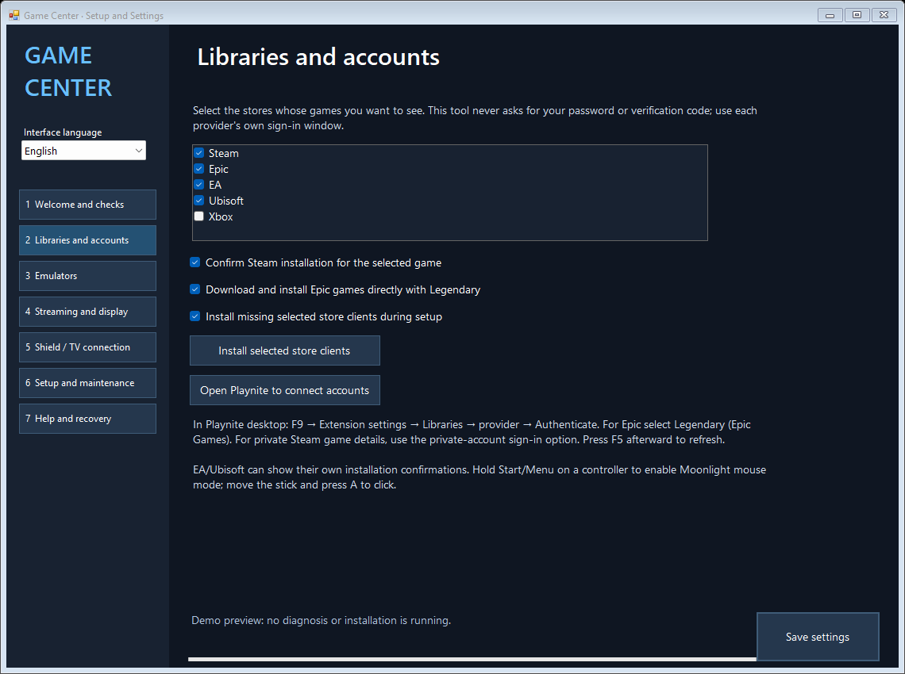
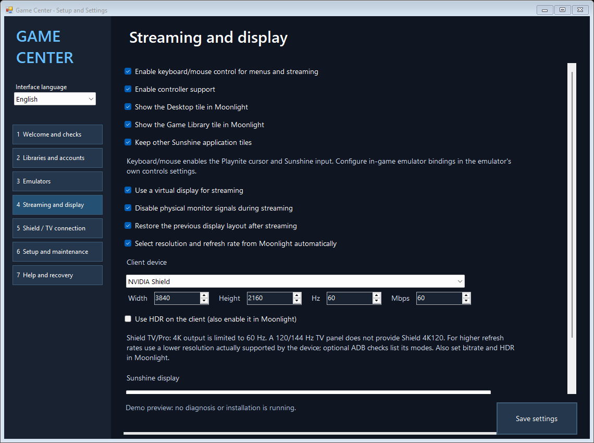
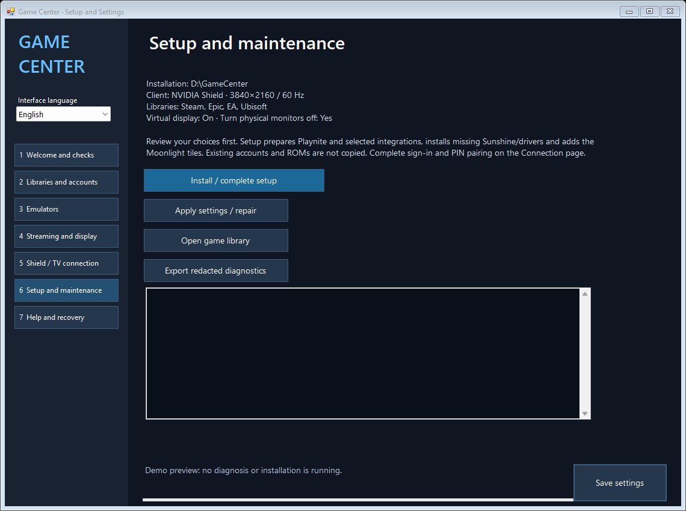

<a href="README.md"><b>English</b></a> · <a href="README.tr.md">Türkçe</a> · <a href="README.fr.md">Français</a> · <a href="README.es.md">Español</a>

<a href="https://github.com/ozi-dev/game-center/releases/latest"><b>Download for Windows</b></a> · <a href="docs/guides/en.md">Installation guide</a> · <a href="#screenshots">Screenshots</a> · <a href="docs/CREDITS.md">Credits</a>

# All your PC games, ready for the couch

**Game Center / Oyun Merkezi** is a Windows setup and settings companion that brings Playnite, Sunshine and Moonlight together. Browse store libraries and local emulators in a controller-friendly library, then play on a TV, NVIDIA Shield or another Moonlight client.

The project configures existing open-source tools and adds installation guidance, emulator history import, missing-cover handling and settings recovery. **Playnite provides the library UI; Sunshine and Moonlight provide streaming.** They deserve the credit for those foundations.

## What you get

| Feature | How it helps |
| --- | --- |
| One library | Steam, Epic, EA, Ubisoft, optional Xbox and local/emulated games through Playnite integrations. |
| Install from the couch | Legendary handles supported Epic downloads; a helper confirms the selected Steam game's install dialog. EA/Ubisoft/Xbox may require their client UI. |
| Emulator history | Import existing Fritchii/Lichii-compatible playtime and RetroArch runtime logs; avoid counting overlapping sessions twice. |
| Cover handling | Extract an available NUP icon or use a `.cover.png` / `.cover.jpg` sidecar. Playnite metadata fills other artwork. |
| Your controls | Controller navigation, keyboard/mouse input, and a visible Playnite cursor. In-game bindings remain in the emulator. |
| Your display | Optional signed virtual display, configurable resolution/refresh rate, physical-monitor signal off during streaming and restoration afterward. |
| Two useful launch tiles | Enable the game library, the desktop, or both. Keep existing Sunshine applications if desired. |
| Guided setup | Detect existing components, download pinned packages, explain account/PIN steps, and optionally inspect a Shield/Android TV using ADB. |
| Recovery | Configuration backups, display recovery shortcut, conflict-aware settings restoration and a redacted diagnostic export. |

## Start playing

1. Download the **Windows x64 ZIP** from [Releases](https://github.com/ozi-dev/game-center/releases/latest).
2. Extract **the entire archive** to a writable folder and run **`Kurulum.exe`**.
3. Follow the seven numbered pages. Choose libraries, add emulator paths, and select your streaming/display preferences.
4. Close Playnite and any active stream before applying. Approve Windows elevation when required; reboot if requested.
5. Sign in to your own store accounts inside Playnite. Pair Moonlight with Sunshine using the displayed PIN.
6. In Moonlight choose **Game Library - Playnite** for the library or **Desktop** for the desktop.

Later, use **Start → Oyun Merkezi → Game Center Settings** to change settings. [Read the English guide](docs/guides/en.md) for account setup and troubleshooting.

**Languages:** the installer, settings and worker messages support **English, Turkish, French and Spanish** in 2.1.0. Choose your language in the sidebar; paths and preferences stay intact. Offline help opens in the selected language. Applying settings also selects that language in Playnite.

## Screenshots

Actual fullscreen Playnite captures from the maintainer’s connected store and emulator libraries, published with permission. These are the same views streamed to the TV; no demo catalog or game was launched. Game names and artwork belong to their respective owners.

| Epic library | Fritchii emulator games |
| --- | --- |
|  |  |

| Game details and imported playtime | Playnite main menu |
| --- | --- |
|  |  |

**Menu navigation**

A short sequence of real Steam, Epic, emulator, game-details and menu views.

The setup screenshots use example paths and show the English UI.

| Libraries | Streaming and display |
| --- | --- |
|  |  |

| Shield / TV | Installation and maintenance |
| --- | --- |
|  |  |

## Compatibility and practical limits

- **Host:** Intel/AMD x64 Windows 10/11, .NET Framework 4.8, PowerShell 5.1, current GPU drivers and a Sunshine-supported hardware encoder. WinGet helps install store clients and missing Microsoft runtimes.
- **Client:** NVIDIA Shield, Android TV/Google TV, or another Moonlight-supported device. ADB is optional; normal streaming does not require it.
- **Shield:** start at 4K60. A 120/144 Hz TV panel does not make Shield output 4K120. Higher refresh rates depend on the client's actual output/decoder modes, cable, host and network. [NVIDIA specifications](https://www.nvidia.com/en-us/shield/shield-tv/).
- Account login, two-factor authentication, pairing and device authorization require the owner. No passwords or pairing keys are distributed.
- Historical emulator time needs a supported log and a matching game ID. Missing history cannot be reconstructed. Playnite tracks new sessions for other configured emulators.
- This is not a universal silent installer for every store or game. Changed client dialogs, first-run agreements and third-party launchers can require Moonlight's controller mouse mode.
- No games, ROMs, BIOS, firmware, keys, saves or game patches are included. Optional TOTK profile buttons edit an already installed compatible local mod; no FPS level is guaranteed.

The initial build passed **15 core + 45 backend + 1,941 localization assertions**, UI checks and a real fresh Playnite/scanner/playtime smoke test. Protected configuration tests mock driver/service boundaries. Physical Shield and every hardware combination have not been tested. [Validation details](docs/TESTING.md).

## Built with, and thanks to

**Josef Nemec and Playnite contributors**, **Sunshine maintainers**, **Moonlight contributors**, **VirtualDrivers**, **Legendary**, **hawkeye116477**, **Libretro**, **Nefarius**, **Igor Pavlov** and the integration maintainers made this workflow possible. Please visit, star and support their projects too.

[Playnite](https://github.com/JosefNemec/Playnite) · [Sunshine](https://github.com/SunshineStream/Sunshine) · [Moonlight](https://github.com/moonlight-stream/moonlight-android) · [Virtual Display Driver](https://github.com/VirtualDrivers/Virtual-Display-Driver) · [Legendary](https://github.com/legendary-gl/legendary) · [Full credits and licenses](docs/CREDITS.md)

## Support and contribute

<!-- SUPPORT-LINK:START -->
You can support the project by starring it, reporting reproducible issues, helping with translations and contributing fixes. A financial-support link will be added after the maintainer's account is active. [Support information](docs/SUPPORT.md).
<!-- SUPPORT-LINK:END -->

[Contributing](CONTRIBUTING.md) · [Build from source](docs/DEVELOPMENT.md) · [Report a bug](https://github.com/ozi-dev/game-center/issues/new/choose)

Original integration code is **MIT licensed**. Downloaded programs and the bundled 7-Zip extractor retain their own licenses; 7-Zip source is included. [Third-party notices](THIRD-PARTY.md). An independent community project by [ozi-dev](https://github.com/ozi-dev); no affiliation with the stores or upstream projects is implied.
