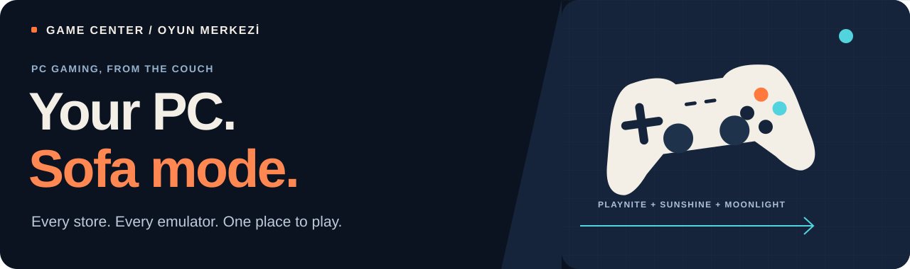
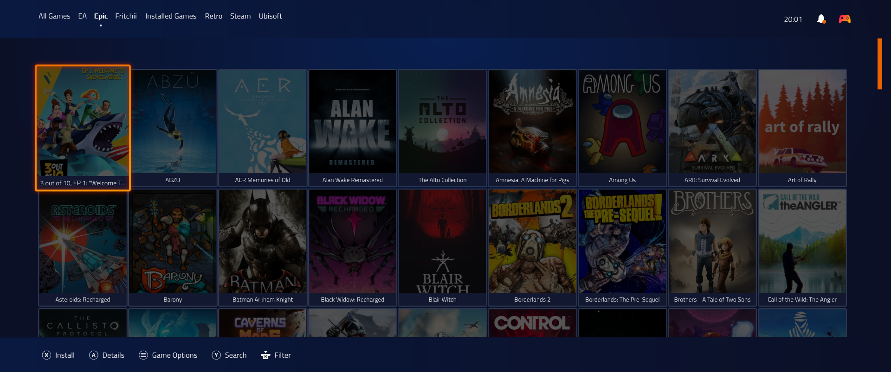
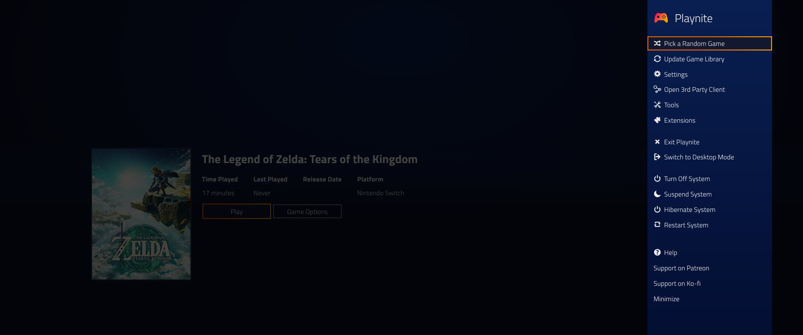
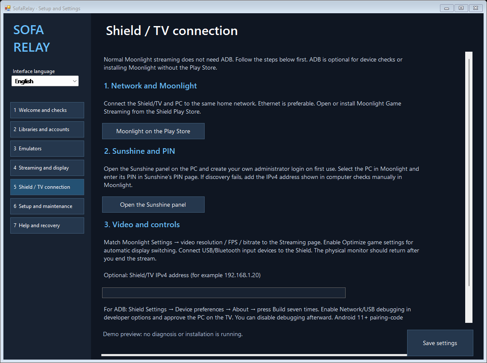
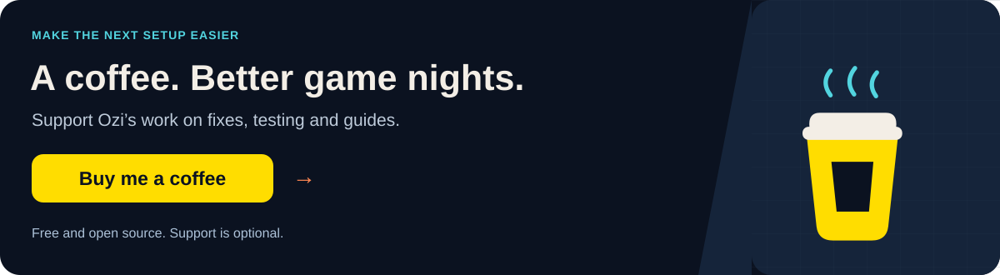

<strong>PUBLIC BETA</strong> · Hardware validation is ongoing. New installations keep the physical monitor on; monitor shutdown is opt-in. <a href="docs/RELEASE-STATUS.md">Tested scenarios and remaining checks</a>

<a href="README.md"><b>English</b></a> &nbsp; · &nbsp; <a href="docs/readme/tr.md">Türkçe</a> &nbsp; · &nbsp; <a href="docs/readme/fr.md">Français</a> &nbsp; · &nbsp; <a href="docs/readme/es.md">Español</a>

<h3 align="center">Your PC library deserves a bigger screen.</h3>

Bring your stores and emulators together. Pick up a controller. Make the TV your next place to play.

  
  &nbsp;
  

  
  
  

<!-- SUPPORT-TOP:START -->

<!-- SUPPORT-TOP:END -->

<b>Steam &nbsp; / &nbsp; Epic &nbsp; / &nbsp; EA &nbsp; / &nbsp; Ubisoft &nbsp; / &nbsp; Xbox &nbsp; / &nbsp; Retro</b>

---

## See it in action

Playnite fullscreen · Steam / Epic / Fritchii · Sunshine + Moonlight

  
  
  

## Make yourself comfortable.

| Feature | What you get |
| :--- | :--- |
| **One place for your games** | Steam, Epic, EA, Ubisoft, optional Xbox and local/emulated games through Playnite integrations. |
| **Install from the couch** | Legendary handles supported Epic downloads. A helper confirms the selected Steam install. Other stores may need their client. |
| **Keep your history** | Import compatible Fritchii/Lichii playtime and RetroArch logs, with overlap handling. |
| **Pick your controls** | Controller, keyboard or mouse. A visible cursor in the library; game bindings stay in the emulator. |
| **Make the screen yours** | Library and desktop tiles, optional virtual display, resolution/Hz and physical-monitor restoration. |
| **Get back safely** | Backups, conflict-aware restore, display recovery shortcut and a redacted diagnostic export. |

## Your games. Front and center.

Real views from the maintainer’s connected libraries. Playnite is the fullscreen interface you stream to your TV.

### Across your stores

Browse an entire connected library, including games ready to install.

### Your progress comes with you

Compatible emulator history appears directly in the game details.

<b>Retro meets the rest · A menu made for the couch</b>

Local emulator games sit alongside your store libraries.

Keep library navigation and settings within reach.

## From download to your sofa.

1. **DOWNLOAD & EXTRACT** — Get the Windows x64 ZIP and extract the whole archive. Open <code>Installer.exe</code>.
2. **CONNECT & CONFIGURE** — Use the seven guided pages to select stores, emulators and display settings. Sign in to your own accounts; pair Moonlight with Sunshine.
3. **PICK YOUR SCREEN** — Choose the library or desktop in Moonlight. Come back to the settings app whenever you want to change things.

[Setup guide](docs/guides/en.md) &nbsp; · &nbsp; Windows 10/11 x64 &nbsp; · &nbsp; TV / NVIDIA Shield / Moonlight

### A setup that speaks your language.

English · Türkçe · Français · Español — the installer, worker messages and offline help follow your selection.

<b>Explore the setup screens</b>

| Connect your libraries | Pair your TV / Shield |
| :---: | :---: |
|  |  |

<b>Before you press play</b>

Windows 10/11 x64, .NET Framework 4.8, PowerShell 5.1, current GPU drivers and a Sunshine-compatible encoder. Internet downloads the selected components.

- Shield, Android TV/Google TV and other Moonlight clients are supported. ADB is optional.
- On Shield, start at 4K60. Higher refresh rates depend on the client’s actual output, decoder, cable, host and network.
- Account login, two-factor authentication and the first PIN pairing are completed on your own devices.
- Some store dialogs and first-run agreements need controller mouse mode or the provider’s UI.
- Historical time needs a supported log and matching game ID. Games, ROMs, BIOS, firmware, keys, saves and patches are not included.

<b>Tested, with the scope visible</b>

20 core + 55 backend + 1,950 localization assertions, wizard checks and native Playnite smoke tests. Physical Shield and every hardware combination have not been tested. [Read the validation scope](docs/TESTING.md).

## Great projects. Shared credit.

Playnite provides the library. Sunshine and Moonlight deliver the stream. SofaRelay adds the guided installation, shared settings, history import and recovery around them.

  <a href="https://github.com/JosefNemec/Playnite"><b>Playnite</b></a> &nbsp; + &nbsp;
  <a href="https://github.com/SunshineStream/Sunshine"><b>Sunshine</b></a> &nbsp; + &nbsp;
  <a href="https://github.com/moonlight-stream/moonlight-android"><b>Moonlight</b></a>

VirtualDrivers · Legendary · hawkeye116477 · Libretro · Nefarius · Igor Pavlov · [Meet the projects behind it](docs/CREDITS.md)

## Make the next setup easier.

<!-- SUPPORT-LINK:START -->

If this project saves you setup time, you can [buy me a coffee](https://buymeacoffee.com/oziooztrk). Contributions, translations and support for the upstream projects are welcome too. Donations are optional; the software remains free and open source.
<!-- SUPPORT-LINK:END -->

[Contribute](CONTRIBUTING.md) &nbsp; · &nbsp; [Build from source](docs/DEVELOPMENT.md) &nbsp; · &nbsp; [Report an issue](https://github.com/ozi-dev/sofarelay/issues/new/choose) &nbsp; · &nbsp; [Support](docs/SUPPORT.md)

---

Original integration code: MIT. Third-party software retains its own licenses. Game names and covers shown in documentation belong to their respective owners. <a href="THIRD-PARTY.md">Licenses &amp; notices</a>.

An independent community project by <a href="https://github.com/ozi-dev"><b>ozi-dev</b></a>.

## Why SofaRelay?

Playnite supplies the library, Sunshine the host and Moonlight the client. SofaRelay connects their setup: store/emulator integration, compatible playtime history, couch install helpers, Desktop/library tiles, display modes, monitor restoration and a guided four-language settings app. You can still use each upstream project independently.

Fritchii/Lichii are user-selected emulator builds supported through compatible launch/history formats; they are not bundled or endorsed.

## Verification, recovery and removal

Before running the unsigned installer, verify the release checksum and build provenance. Help includes ownership-aware removal, optional sign-in display recovery and LAN-only controls. Sunshine asks you to create your own password; local streaming needs no router port forwarding.

[SHA-256 / provenance](docs/VERIFYING.md) · [Troubleshooting](docs/TROUBLESHOOTING.md) · [Uninstall](docs/UNINSTALL.md) · [Validation / upstream versions](docs/TESTING.md) · [2.3 audit](docs/AUDIT-2.3.md)
