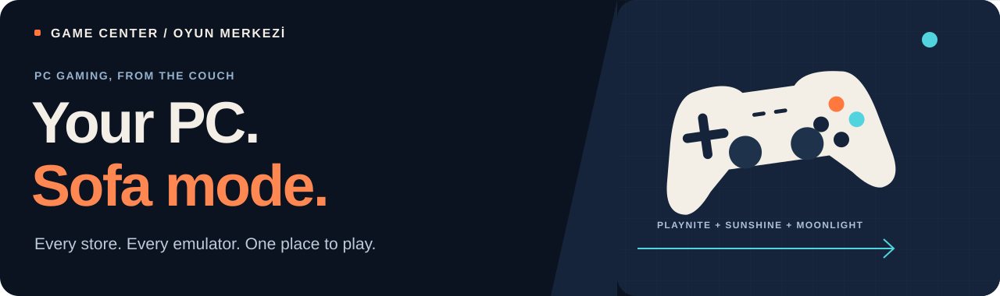
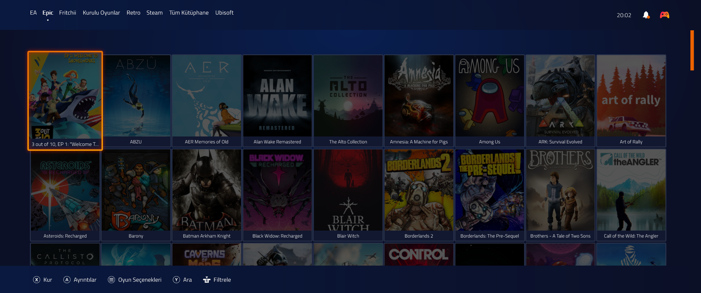
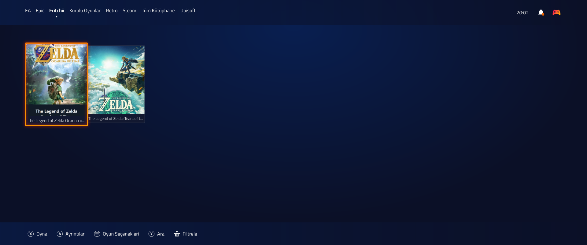
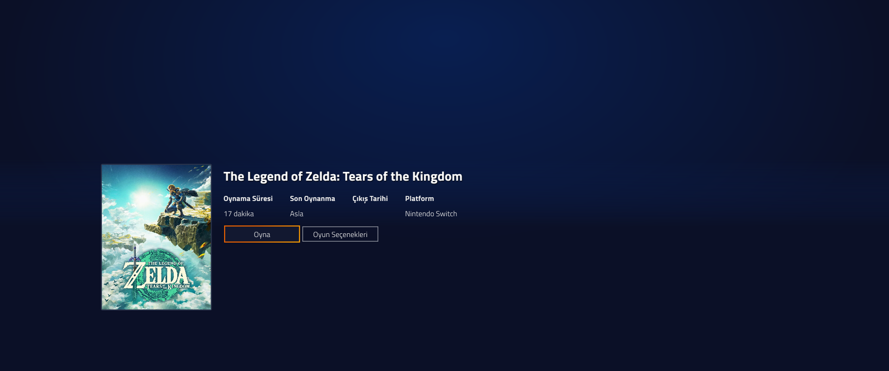
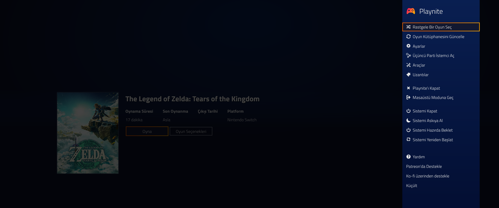
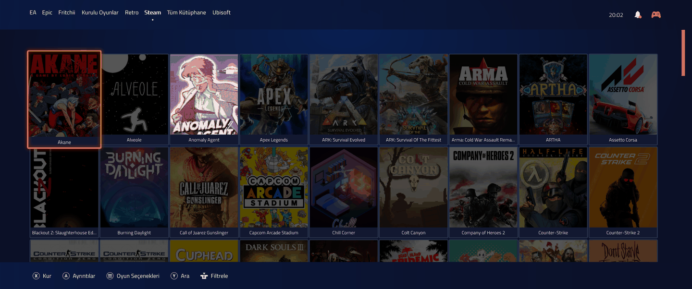
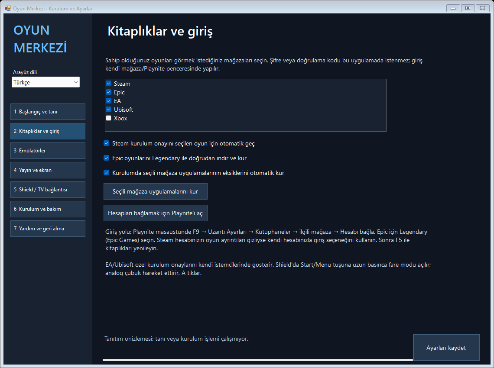
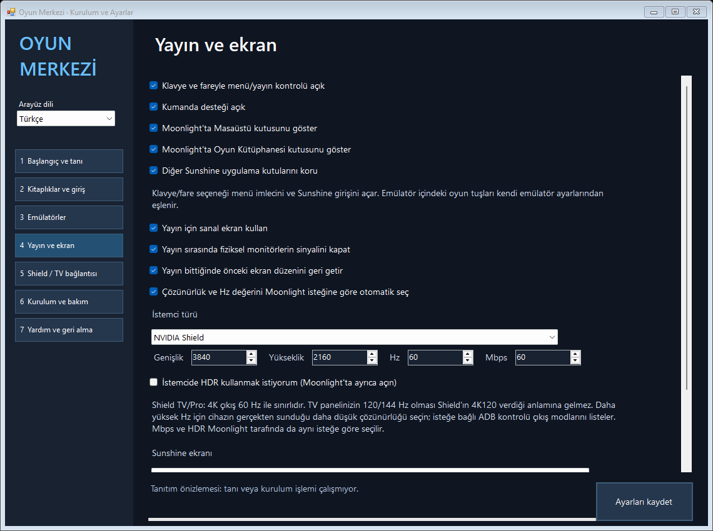
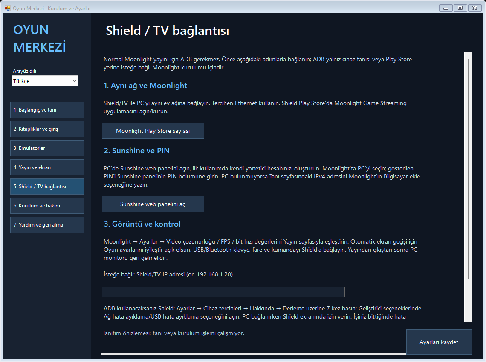
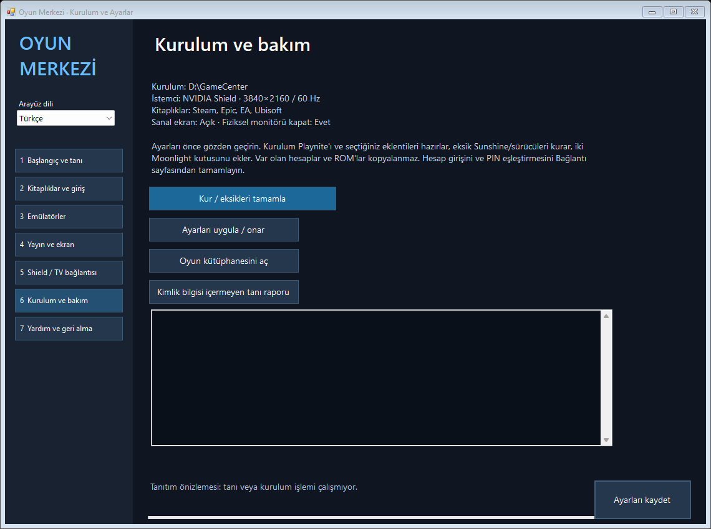

<a href="README.md">English</a> · <a href="README.tr.md"><b>Türkçe</b></a> · <a href="README.fr.md">Français</a> · <a href="README.es.md">Español</a>

<a href="https://github.com/ozi-dev/game-center/releases/latest"><b>Windows için indir</b></a> · <a href="docs/guides/tr.md">Kurulum rehberi</a> · <a href="docs/CREDITS.md">Emeği geçenler</a>

# PC'deki oyunların, koltuktan erişebildiğin tek kütüphanede

**Game Center / Oyun Merkezi**, Playnite, Sunshine ve Moonlight kurulumunu bir araya getiren bir Windows yardımcı uygulaması. Mağaza oyunlarını ve yerel emülatörlerini kumandayla kullanabildiğin bir kütüphanede topla; TV, NVIDIA Shield veya başka bir Moonlight cihazından oyna.

**Kütüphane arayüzünü Playnite, yayını Sunshine ve Moonlight sağlıyor.** Bu proje onların üzerine kurulum yönlendirmesi, ortak ayarlar, emülatör geçmişi aktarımı, kapak tamamlama ve kurtarma araçları ekliyor. Temel projelere ve geliştiricilerine teşekkür ediyoruz.

## Neler yapıyor?

| Özellik | Sağladığı kolaylık |
| --- | --- |
| Tek kütüphane | Playnite üzerinden Steam, Epic, EA, Ubisoft, isteğe bağlı Xbox ve yerel/emülatör oyunları. |
| TV'den kurulum | Desteklenen Epic oyunlarında Legendary ile indirme; Steam'de seçilen oyunun kurulum onayını geçme. Diğer istemciler ek etkileşim isteyebilir. |
| Emülatör süreleri | Fritchii/Lichii uyumlu geçmişi ve RetroArch çalışma günlüklerini aktarır; aynı oturumu iki kez saymamaya çalışır. |
| Kapaklar | NUP içindeki uygun ikon veya `.cover.png` / `.cover.jpg` yan dosyası. Diğer kapaklar Playnite metadata sağlayıcısından. |
| Kontroller | Kumanda, klavye/fare ve görünür menü imleci. Oyun içi tuşlar emülatörde eşlenir. |
| Yayın ekranı | İsteğe bağlı imzalı sanal ekran; çözünürlük/Hz seçimi; yayın sırasında fiziksel ekran sinyalini kapatma ve sonrasında geri getirme. |
| Moonlight kutuları | Kütüphane, masaüstü veya ikisi birden; mevcut diğer kutuları koruma seçeneği. |
| Rehberli kurulum | Eksik bileşenler, hesap girişleri, PIN eşleşmesi; isteğe bağlı ADB cihaz tanısı. |
| Kurtarma | Ayar yedeği, ekran kurtarma kısayolu, sonradan değişmiş dosyaları ezmeyen geri alma ve kimliksiz tanı raporu. |

## Başlamak için

1. [Sürümler](https://github.com/ozi-dev/game-center/releases/latest) sayfasındaki Windows x64 ZIP dosyasını indir.
2. ZIP'in **tamamını** bir klasöre çıkar; **`Kurulum.exe`** dosyasını aç.
3. Yedi adımı izle: mağazaları seç, emülatör yollarını ekle, yayın tercihlerini ayarla.
4. Uygulamadan önce Playnite'ı ve yayını kapat; istenirse Windows yönetici onayını ve yeniden başlatmayı tamamla.
5. Playnite'ta kendi mağaza hesaplarına giriş yap; Moonlight PIN'ini Sunshine'da onayla.
6. Moonlight'ta **Oyun Kütüphanesi - Playnite** veya **Masaüstü - Desktop** kutusunu aç.

Sonraki değişiklikler: **Başlat → Oyun Merkezi → Oyun Merkezi Ayarları**. [Türkçe rehber](docs/guides/tr.md) ve paketteki ayrıntılı `README.html` bağımsız kurulumu anlatıyor.

**Dil seçenekleri:** 2.1.0 kurucusu, ayarlar ve işlem mesajları **İngilizce, Türkçe, Fransızca ve İspanyolca** çalışır. Sol menüden dili değiştirebilirsin; yollar ve tercihler korunur. Çevrimdışı yardım seçtiğin dilde açılır. Ayarları uygulamak Playnite dilini de buna göre seçer.

## Ekran görüntüleri

Playnite tam ekran görüntüleri, geliştiricinin bağlı mağaza hesaplarından ve gerçek emülatör kütüphanesinden, izniyle alındı. TV’ye aktarılan arayüz budur; demo katalog kullanılmadı ve oyun başlatılmadı. Oyun adları ve kapaklar ilgili hak sahiplerine aittir.

| Epic kütüphanesi | Fritchii emülatör oyunları |
| --- | --- |
|  |  |

| Oyun ayrıntıları ve aktarılan süre | Playnite ana menüsü |
| --- | --- |
|  |  |

**Menüler arası geçiş**

Gerçek Steam, Epic, emülatör, oyun ayrıntıları ve menü görünümlerinden kısa bir geçiş dizisi.

Kurulum görüntüleri örnek yollarla, Türkçe arayüzden alındı.

| Kütüphaneler | Yayın ve ekran |
| --- | --- |
|  |  |

| Shield / TV | Kurulum ve bakım |
| --- | --- |
|  |  |

## Uyumluluk

- Intel/AMD x64 Windows 10/11, .NET Framework 4.8, PowerShell 5.1 ve Sunshine'ın desteklediği GPU kodlayıcı gerekir. WinGet, mağaza uygulamaları ve Microsoft çalışma zamanlarının kurulumunu kolaylaştırır.
- Shield, Android TV/Google TV ve diğer Moonlight istemcileri kullanılabilir. **ADB zorunlu değildir.**
- **Shield için 4K60 ile başla.** TV panelinin yüksek Hz değeri Shield'a 4K120 çıkış kazandırmaz. Daha yüksek Hz için cihazın gerçek çıkış ve çözme desteği gerekir. [NVIDIA özellikleri](https://www.nvidia.com/en-us/shield/shield-tv/).
- Hesap girişi, iki aşamalı doğrulama, PIN ve cihaz izni kullanıcı tarafından tamamlanır. Mağaza onaylarında kumandanın fare modu kullanılabilir.
- Eski sürelerin aktarılması için desteklenen kayıt ve doğru oyun kimliği gerekir; hiç kaydedilmemiş süre hesaplanamaz.
- Oyun, ROM, BIOS, firmware, anahtar, kayıt ve oyun modu dağıtılmaz. TOTK düğmeleri zaten kurulmuş uyumlu yerel profili düzenler; sabit FPS sözü vermez.

15 çekirdek + 45 arka uç + 1.941 yerelleştirme kontrolü, arayüz denetimleri ve temiz Playnite/tarama/süre aktarımı denemesi geçti. Shield'ın fiziksel testi ve her donanım kombinasyonu doğrulanmış değil. [Test kapsamı](docs/TESTING.md).

## Emeği geçenler ve destek

[Playnite](https://github.com/JosefNemec/Playnite), [Sunshine](https://github.com/SunshineStream/Sunshine), [Moonlight](https://github.com/moonlight-stream/moonlight-android), [VirtualDrivers](https://github.com/VirtualDrivers/Virtual-Display-Driver), [Legendary](https://github.com/legendary-gl/legendary), hawkeye116477, Libretro, Nefarius, Igor Pavlov ve eklenti geliştiricilerine teşekkürler. Onların projelerini de ziyaret edip destekleyebilirsin. [Katkılar ve lisanslar](docs/CREDITS.md).

<!-- SUPPORT-LINK:START -->
Yıldız vererek, hata bildirerek, çevirilere ve koda katkıda bulunarak destek olabilirsin. Maddi destek bağlantısı, geliştiricinin hesabı aktif olduğunda eklenecek. [Destek bilgisi](docs/SUPPORT.md).
<!-- SUPPORT-LINK:END -->

[Katkı rehberi](CONTRIBUTING.md) · [Kaynaklardan derleme](docs/DEVELOPMENT.md) · [Hata bildir](https://github.com/ozi-dev/game-center/issues/new/choose)

Özgün entegrasyon kodu **MIT** lisanslıdır. Diğer yazılımlar kendi lisanslarını korur. [Üçüncü taraf bildirimleri](THIRD-PARTY.md). [ozi-dev](https://github.com/ozi-dev) tarafından geliştirilen bağımsız bir topluluk projesidir.
