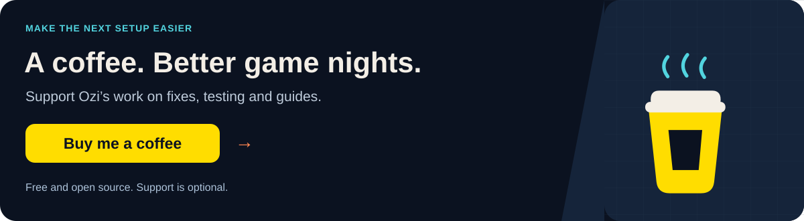

# Support the project

SofaRelay is free and open source. Stars, reproducible bug reports, translations, documentation improvements and code contributions are useful forms of support. Please also support the [upstream projects](CREDITS.md) that provide the library, streaming and emulation foundations.

<!-- SUPPORT-LINK:START -->
You can [buy the maintainer a coffee](https://buymeacoffee.com/oziooztrk). Donations are optional, provide no special entitlement and do not change the project's free/open-source status. Please support the upstream maintainers too.
<!-- SUPPORT-LINK:END -->

## A coffee for the next game night

<a href="https://buymeacoffee.com/oziooztrk"></a>

SofaRelay is maintained by [Ozi](https://github.com/ozi-dev). A coffee supports time spent on fixes, compatibility testing and documentation. It does not purchase features, priority support or a compatibility guarantee. The project is a [public beta](RELEASE-STATUS.md), and its current limits remain documented.

Thank you for supporting this project and the people behind [Playnite, Sunshine, Moonlight and the other foundations](CREDITS.md).

## Maintainer: keep the links in sync

The confirmed public profile is [buymeacoffee.com/oziooztrk](https://buymeacoffee.com/oziooztrk). If the handle changes, update GitHub's Sponsor button, the top buttons and all four localized README support banners together:

```powershell
powershell -NoProfile -ExecutionPolicy Bypass -File .\scripts\maintainer\Set-Funding.ps1 -PublicUrl "https://buymeacoffee.com/oziooztrk"
```

Editable [cover artwork](media/support/coffee-cover.svg), a ready-to-upload [1600 × 400 PNG cover](media/support/coffee-cover.png) and a [project introduction image](media/support/coffee-intro.png) are available. The introduction uses the maintainer's real connected game library. Keep private account, payout and identity details outside this repository.
