
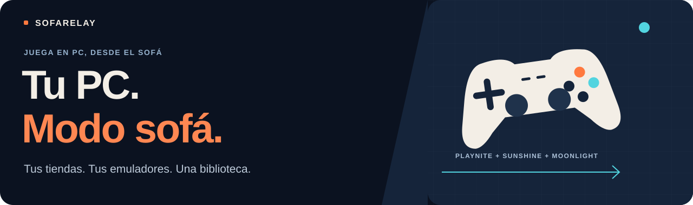

<strong>BETA PÚBLICA</strong> · La validación de hardware continúa. Las instalaciones nuevas mantienen el monitor físico encendido; apagarlo es opcional. <a href="../RELEASE-STATUS.md">Casos probados y comprobaciones pendientes</a>

<a href="../../README.md">English</a> &nbsp; · &nbsp; <a href="../../docs/readme/tr.md">Türkçe</a> &nbsp; · &nbsp; <a href="../../docs/readme/fr.md">Français</a> &nbsp; · &nbsp; <a href="../../docs/readme/es.md"><b>Español</b></a>

<h3 align="center">Tu biblioteca merece una pantalla más grande.</h3>

Reúne tus tiendas y emuladores. Toma el mando. Lleva tus juegos al televisor.

  
  &nbsp;
  

  
  
  

<!-- SUPPORT-TOP:START -->

<!-- SUPPORT-TOP:END -->

<b>Steam &nbsp; / &nbsp; Epic &nbsp; / &nbsp; EA &nbsp; / &nbsp; Ubisoft &nbsp; / &nbsp; Xbox &nbsp; / &nbsp; Retro</b>

---

## Ver en acción

<a href="../../docs/screenshots/es/navigation.gif">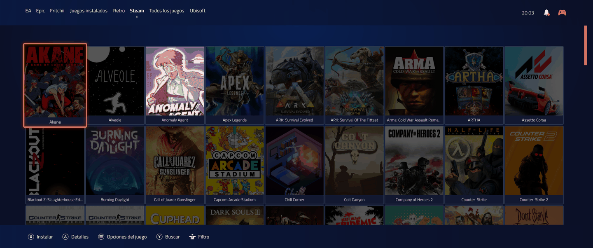</a>

Playnite fullscreen · Steam / Epic / Fritchii · Sunshine + Moonlight

  
  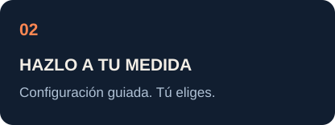
  

## Ponte cómodo.

| Función | Qué te ofrece |
| :--- | :--- |
| **Tus juegos en un lugar** | Steam, Epic, EA, Ubisoft, Xbox opcional y juegos locales/emulados con las integraciones de Playnite. |
| **Instala desde el sofá** | Legendary descarga juegos Epic compatibles. Un asistente confirma la instalación Steam elegida. Otras tiendas pueden necesitar su cliente. |
| **Conserva tu historial** | Importa tiempo compatible de Fritchii/Lichii y registros RetroArch, teniendo en cuenta las sesiones compartidas. |
| **Elige tus controles** | Mando, teclado o ratón. Cursor visible en la biblioteca; los controles del juego se ajustan en el emulador. |
| **La pantalla a tu medida** | Accesos a biblioteca/escritorio, pantalla virtual opcional, resolución/Hz y restauración del monitor físico. |
| **Recupera tus ajustes** | Copias, restauración con detección de conflictos, atajo para recuperar la pantalla y diagnóstico sin datos personales. |

## Tus juegos, en primer plano.

Vistas reales de las bibliotecas conectadas del responsable. Playnite ofrece la interfaz completa que se transmite al televisor.

### Tus tiendas reunidas

Explora la biblioteca, incluidos los juegos que puedes instalar.

<a href="../../docs/screenshots/es/catalog.png">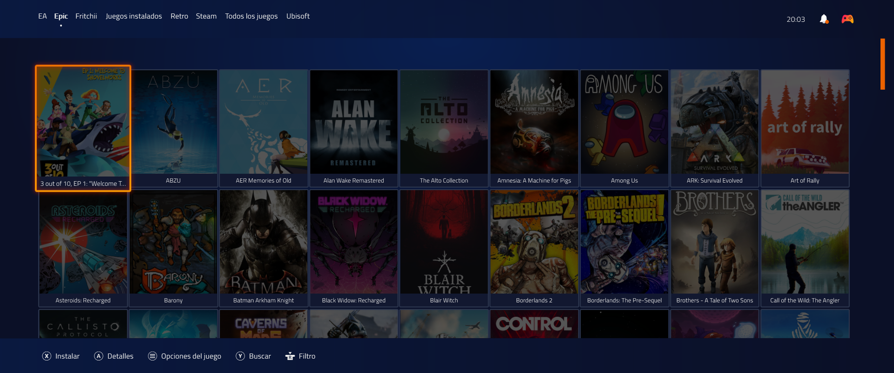</a>

### Tu progreso te acompaña

El historial compatible de los emuladores aparece en los detalles del juego.

<a href="../../docs/screenshots/es/game-details.png">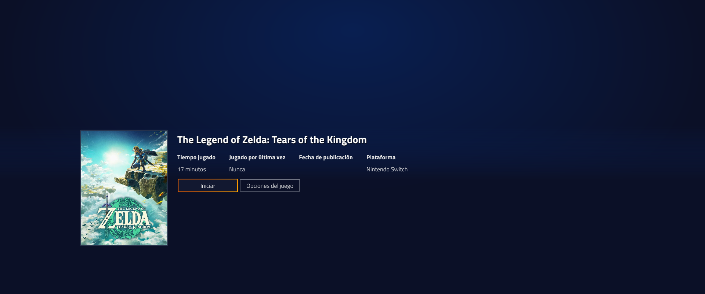</a>

<b>El retro también tiene sitio · Navega desde el sofá</b>

Tus emuladores locales comparten biblioteca con los juegos de las tiendas.

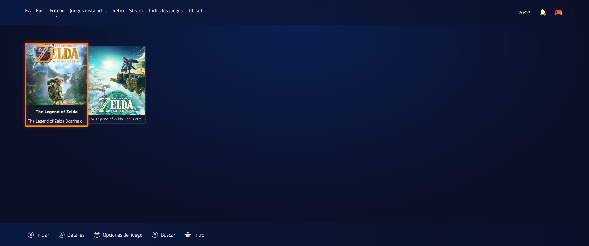

La biblioteca y los ajustes quedan al alcance de la mano.

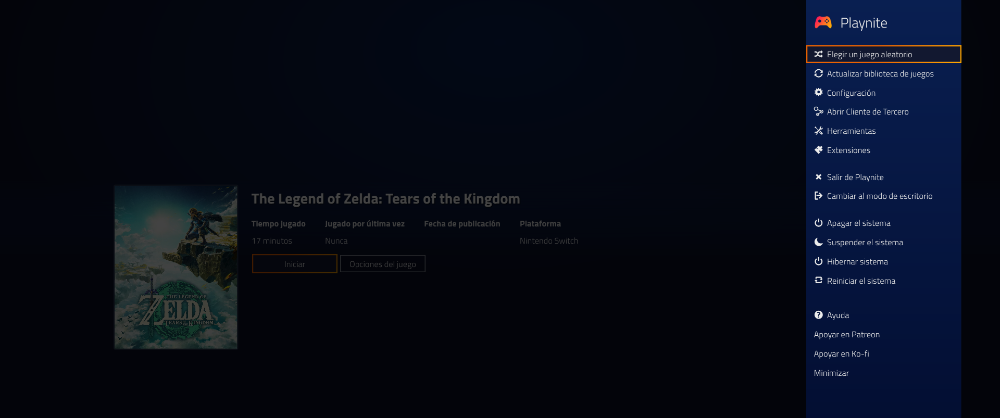

## De la descarga al sofá.

1. **DESCARGA Y EXTRAE** — Extrae todo el ZIP de Windows x64 y abre <code>Installer.exe</code>.
2. **CONECTA Y CONFIGURA** — Sigue las siete páginas para elegir tiendas, emuladores y pantalla. Inicia sesión en tus cuentas y empareja Moonlight con Sunshine.
3. **ELIGE TU PANTALLA** — Abre la biblioteca o el escritorio en Moonlight. Vuelve a los ajustes cuando quieras cambiar tus preferencias.

[Guía de instalación](../../docs/guides/es.md) &nbsp; · &nbsp; Windows 10/11 x64 &nbsp; · &nbsp; TV / NVIDIA Shield / Moonlight

### Una instalación que habla tu idioma.

English · Türkçe · Français · Español — el asistente, los mensajes y la ayuda sin conexión siguen tu selección.

<a href="../../docs/screenshots/es/page-4.png">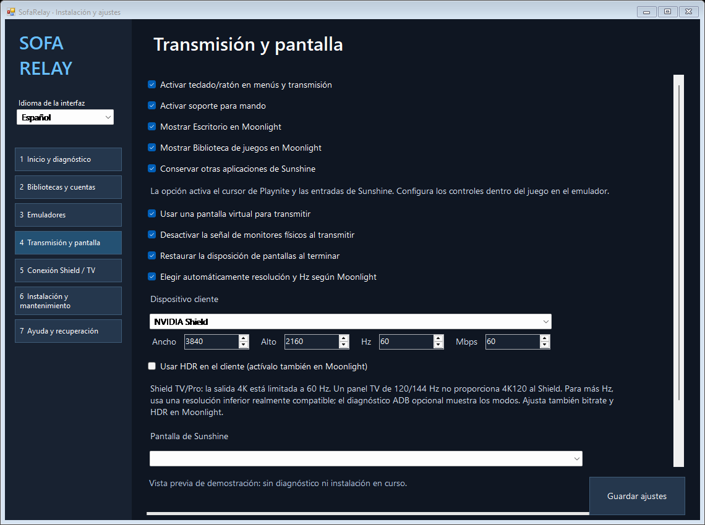</a>

<b>Explorar la configuración</b>

| Conecta tus bibliotecas | Empareja TV / Shield |
| :---: | :---: |
| 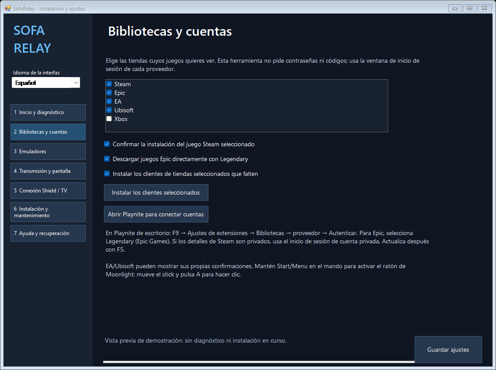 | 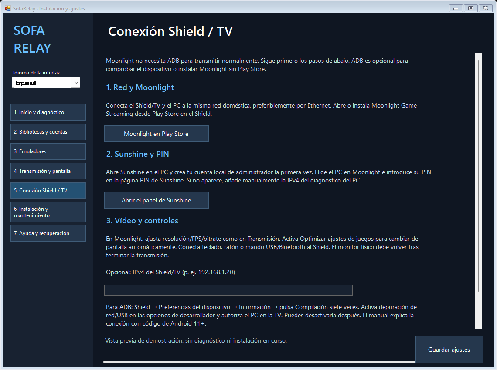 |

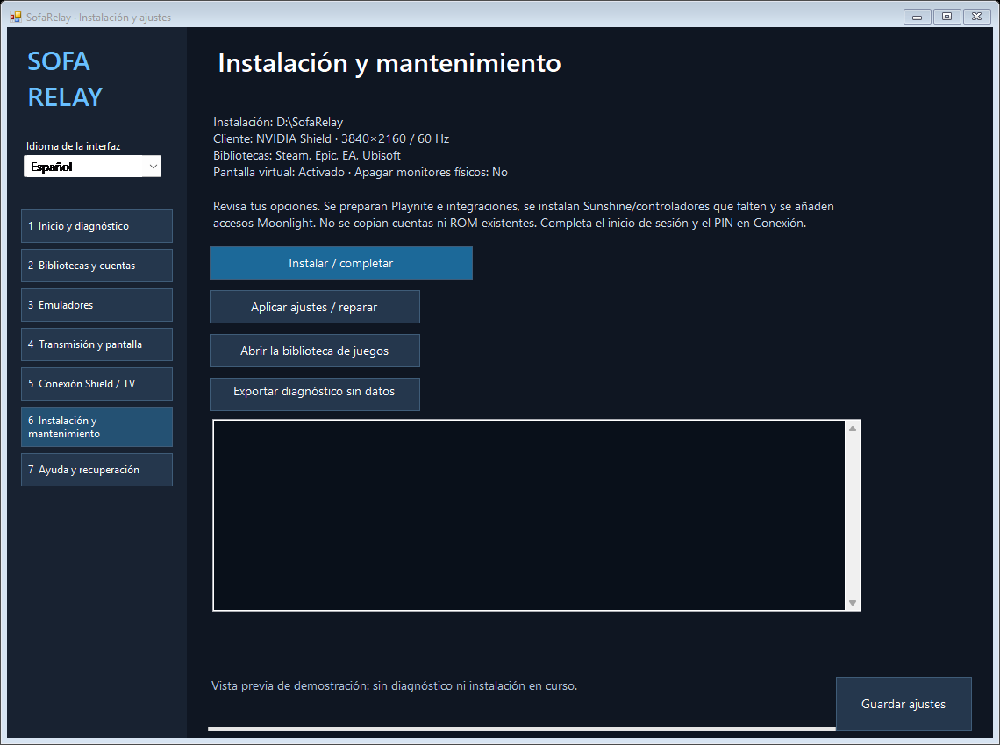

<b>Antes de jugar</b>

Windows 10/11 x64, .NET Framework 4.8, PowerShell 5.1, controladores GPU actuales y un codificador compatible con Sunshine. Internet descarga los componentes seleccionados.

- Compatible con Shield, Android TV/Google TV y otros clientes Moonlight. ADB es opcional.
- En Shield, empieza con 4K60. Las frecuencias superiores dependen de la salida real del cliente, el decodificador, el cable, el PC y la red.
- El inicio de sesión, la autenticación de dos factores y el primer PIN se completan en tus propios dispositivos.
- Algunas tiendas y acuerdos iniciales requieren su interfaz o el modo ratón del mando.
- El historial necesita un registro compatible y un identificador correcto. No se incluyen juegos, ROM, BIOS, firmware, claves, partidas ni parches.

<b>Pruebas con un alcance claro.</b>

20 comprobaciones del núcleo, 55 del backend y 1950 de localización, controles del asistente y pruebas reales de Playnite. No se ha probado un Shield físico ni todas las combinaciones de hardware. [Consultar la validación](../../docs/TESTING.md).

## Grandes proyectos. Mérito compartido.

Playnite ofrece la biblioteca. Sunshine y Moonlight transmiten los juegos. SofaRelay añade instalación guiada, ajustes compartidos, historial y recuperación.

  <a href="https://github.com/JosefNemec/Playnite"><b>Playnite</b></a> &nbsp; + &nbsp;
  <a href="https://github.com/SunshineStream/Sunshine"><b>Sunshine</b></a> &nbsp; + &nbsp;
  <a href="https://github.com/moonlight-stream/moonlight-android"><b>Moonlight</b></a>

VirtualDrivers · Legendary · hawkeye116477 · Libretro · Nefarius · Igor Pavlov · [Conoce los proyectos que lo hacen posible](../../docs/CREDITS.md)

## Facilita la próxima instalación.

<!-- SUPPORT-LINK:START -->
<a href="https://buymeacoffee.com/oziooztrk">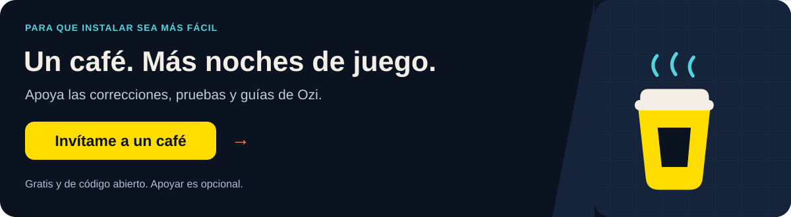</a>

Si este proyecto te ahorra tiempo, puedes [invitarme a un café](https://buymeacoffee.com/oziooztrk). También agradecemos las contribuciones, traducciones y el apoyo a los proyectos originales. Donar es opcional; el programa sigue siendo gratuito y de código abierto.
<!-- SUPPORT-LINK:END -->

[Contribuir](../../CONTRIBUTING.md) &nbsp; · &nbsp; [Compilar](../../docs/DEVELOPMENT.md) &nbsp; · &nbsp; [Informar de un error](https://github.com/ozi-dev/sofarelay/issues/new/choose) &nbsp; · &nbsp; [Apoyar](../../docs/SUPPORT.md)

---

Código de integración original con licencia MIT. Los componentes externos conservan sus licencias. Los títulos y las carátulas pertenecen a sus titulares. <a href="../../THIRD-PARTY.md">Licencias y avisos</a>.

Un proyecto comunitario independiente de <a href="https://github.com/ozi-dev"><b>ozi-dev</b></a>.

## ¿Por qué SofaRelay?

Playnite aporta la biblioteca, Sunshine el servidor y Moonlight el cliente. SofaRelay conecta su configuración: tiendas y emuladores, historial compatible, ayudas de instalación desde el sofá, accesos Desktop/biblioteca, modos de pantalla y ajustes guiados en cuatro idiomas. Los proyectos originales también se pueden usar por separado.

Fritchii/Lichii son compilaciones de emulador elegidas por el usuario con formatos compatibles de ejecución e historial; no se incluyen ni se avalan.

## Verificación, recuperación y desinstalación

Antes de ejecutar este instalador sin firma, verifica la suma y la procedencia de compilación. Ayuda ofrece eliminación según propiedad, recuperación al iniciar sesión y modo de red local. Tú creas la contraseña de Sunshine; no hace falta abrir puertos del router.

[SHA-256 / provenance](../VERIFYING.md) · [Troubleshooting](../TROUBLESHOOTING.md) · [Uninstall](../UNINSTALL.md) · [Validation / upstream versions](../TESTING.md) · [2.3 audit](../AUDIT-2.3.md)
