
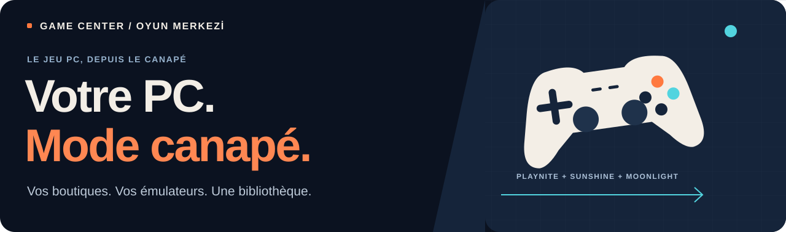

<strong>BÊTA PUBLIQUE</strong> · La validation matérielle continue. Les nouvelles installations laissent le moniteur physique allumé ; son extinction est facultative. <a href="../RELEASE-STATUS.md">Scénarios testés et vérifications restantes</a>

<a href="../../README.md">English</a> &nbsp; · &nbsp; <a href="../../docs/readme/tr.md">Türkçe</a> &nbsp; · &nbsp; <a href="../../docs/readme/fr.md"><b>Français</b></a> &nbsp; · &nbsp; <a href="../../docs/readme/es.md">Español</a>

<h3 align="center">Votre bibliothèque mérite un plus grand écran.</h3>

Réunissez vos boutiques et vos émulateurs. Prenez une manette. Retrouvez vos jeux sur le téléviseur.

  
  &nbsp;
  

  
  
  

<b>Steam &nbsp; / &nbsp; Epic &nbsp; / &nbsp; EA &nbsp; / &nbsp; Ubisoft &nbsp; / &nbsp; Xbox &nbsp; / &nbsp; Retro</b>

---

## Voir en action

<a href="../../docs/screenshots/fr/navigation.gif">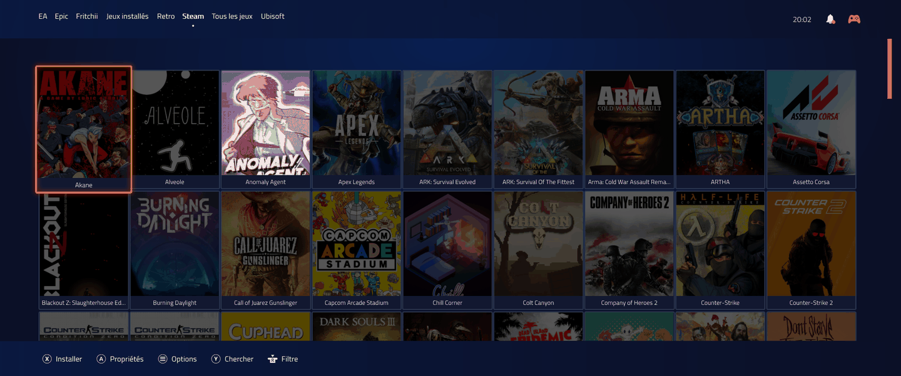</a>

Playnite fullscreen · Steam / Epic / Fritchii · Sunshine + Moonlight

  
  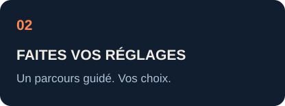
  

## Installez-vous confortablement.

| Fonction | Ce que vous y gagnez |
| :--- | :--- |
| **Vos jeux au même endroit** | Steam, Epic, EA, Ubisoft, Xbox en option et jeux locaux/émulés via les intégrations Playnite. |
| **Installer depuis le canapé** | Legendary télécharge les jeux Epic compatibles. Un assistant confirme l’installation Steam sélectionnée. Les autres boutiques peuvent demander leur client. |
| **Gardez votre historique** | Importez les durées Fritchii/Lichii compatibles et les journaux RetroArch, avec gestion des sessions communes. |
| **Choisissez vos commandes** | Manette, clavier ou souris. Curseur visible dans la bibliothèque ; les touches en jeu restent configurées dans l’émulateur. |
| **Un écran à votre mesure** | Accès bibliothèque/bureau, écran virtuel facultatif, résolution/fréquence et restauration du moniteur physique. |
| **Retrouvez vos réglages** | Sauvegardes, restauration avec détection des conflits, raccourci de récupération de l’écran et diagnostic expurgé. |

## Vos jeux au premier plan.

Vues réelles des bibliothèques connectées du mainteneur. Playnite fournit l’interface plein écran diffusée sur le téléviseur.

### Vos boutiques réunies

Parcourez votre bibliothèque, y compris les jeux à installer.

<a href="../../docs/screenshots/fr/catalog.png">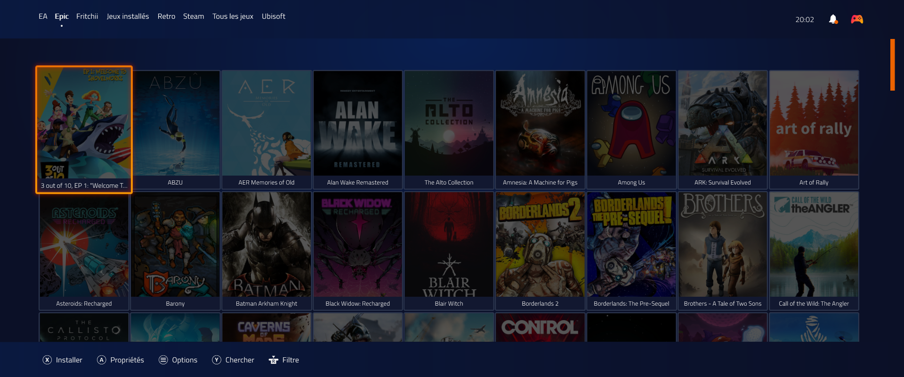</a>

### Votre progression vous suit

L’historique compatible des émulateurs apparaît dans les détails du jeu.

<a href="../../docs/screenshots/fr/game-details.png">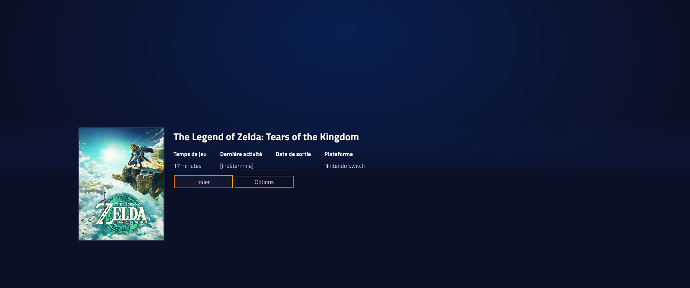</a>

<b>Le rétro trouve sa place · Naviguez depuis le canapé</b>

Vos émulateurs locaux côtoient les jeux de vos boutiques.

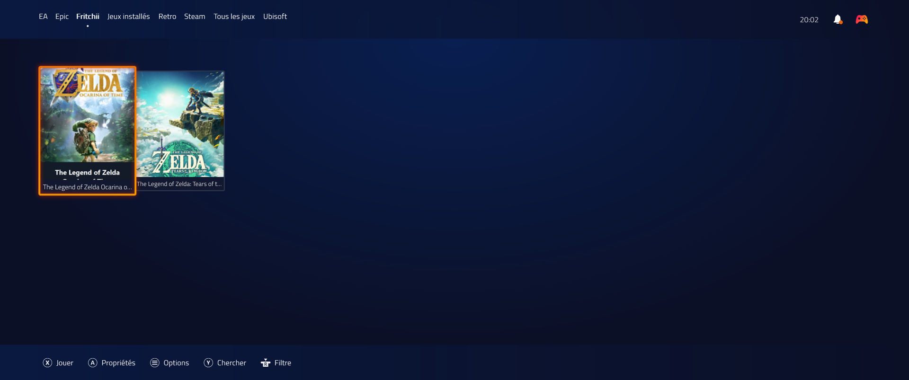

La bibliothèque et les réglages restent à portée de main.

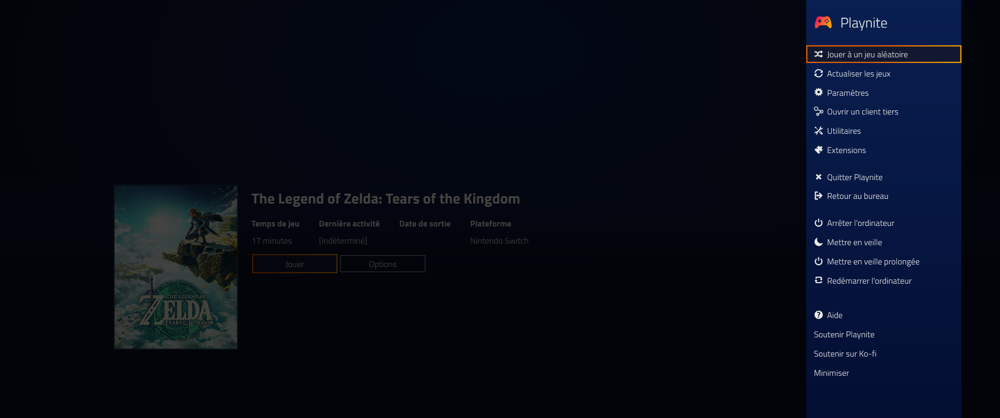

## Du téléchargement au canapé.

1. **TÉLÉCHARGEZ ET EXTRAYEZ** — Extrayez tout le ZIP Windows x64, puis ouvrez <code>Installer.exe</code>.
2. **CONNECTEZ ET CONFIGUREZ** — Suivez les sept pages pour choisir boutiques, émulateurs et écran. Connectez vos comptes, puis associez Moonlight à Sunshine.
3. **CHOISISSEZ VOTRE ÉCRAN** — Ouvrez la bibliothèque ou le bureau dans Moonlight. Retrouvez vos préférences dans l’application de réglages.

[Guide d’installation](../../docs/guides/fr.md) &nbsp; · &nbsp; Windows 10/11 x64 &nbsp; · &nbsp; TV / NVIDIA Shield / Moonlight

### Une installation dans votre langue.

English · Türkçe · Français · Español — l’assistant, les messages et l’aide hors ligne suivent votre sélection.

<a href="../../docs/screenshots/fr/page-4.png">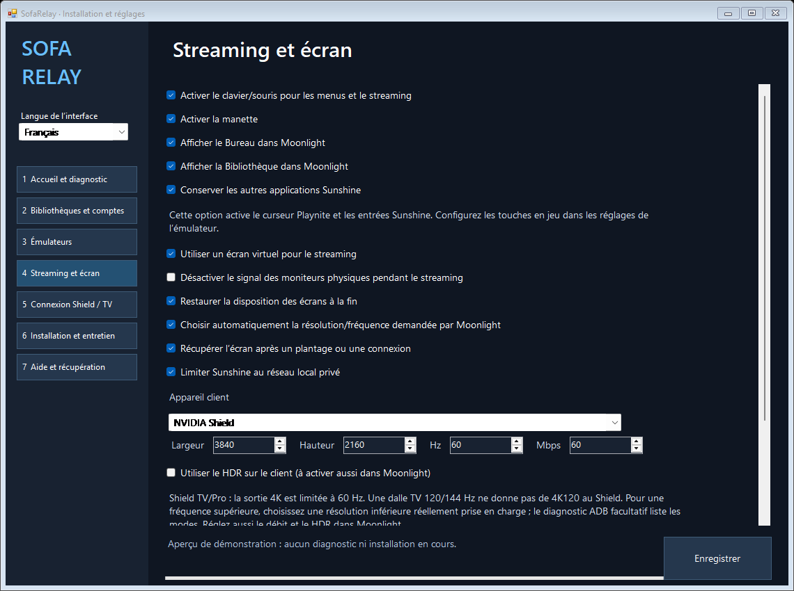</a>

<b>Explorer les écrans de configuration</b>

| Connectez vos bibliothèques | Associez le TV / Shield |
| :---: | :---: |
| 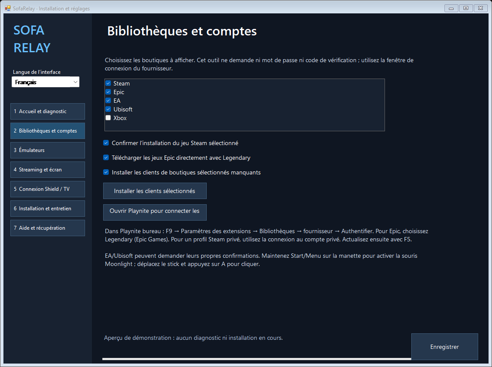 | 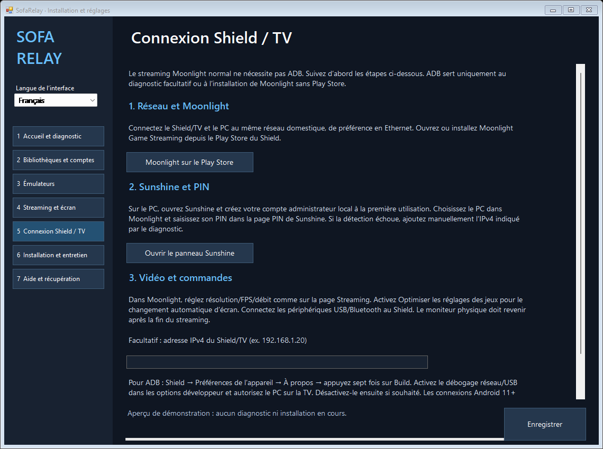 |

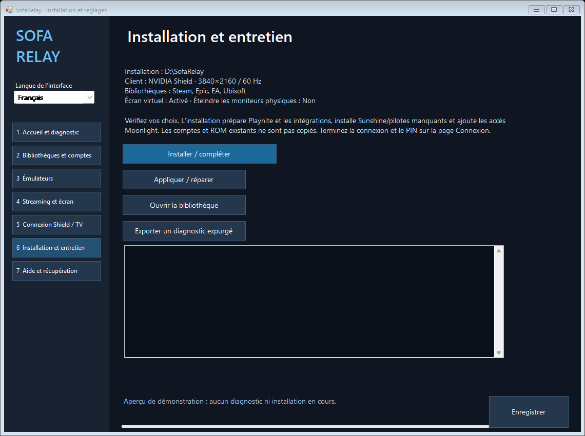

<b>Avant de jouer</b>

Windows 10/11 x64, .NET Framework 4.8, PowerShell 5.1, pilotes GPU récents et encodeur compatible Sunshine. Internet sert à télécharger les composants choisis.

- Shield, Android TV/Google TV et autres clients Moonlight sont compatibles. ADB est facultatif.
- Sur Shield, commencez en 4K60. Les fréquences supérieures dépendent de la sortie réelle du client, du décodage, du câble, du PC et du réseau.
- Authentification, double vérification et première association par PIN se font sur vos propres appareils.
- Certaines boutiques et conditions de première utilisation nécessitent leur interface ou le mode souris de la manette.
- L’historique exige un journal compatible et un identifiant correct. Aucun jeu, ROM, BIOS, firmware, clé, sauvegarde ou correctif n’est fourni.

<b>Un périmètre de test transparent.</b>

20 vérifications du cœur, 55 du backend et 1 950 de localisation, contrôles de l’assistant et tests Playnite réels. Le Shield physique et toutes les configurations matérielles n’ont pas été testés. [Lire le périmètre de validation](../../docs/TESTING.md).

## De beaux projets. Un travail partagé.

Playnite fournit la bibliothèque. Sunshine et Moonlight assurent le streaming. SofaRelay ajoute l’installation guidée, les réglages communs, l’historique et la récupération.

  <a href="https://github.com/JosefNemec/Playnite"><b>Playnite</b></a> &nbsp; + &nbsp;
  <a href="https://github.com/SunshineStream/Sunshine"><b>Sunshine</b></a> &nbsp; + &nbsp;
  <a href="https://github.com/moonlight-stream/moonlight-android"><b>Moonlight</b></a>

VirtualDrivers · Legendary · hawkeye116477 · Libretro · Nefarius · Igor Pavlov · [Découvrir les projets à l’origine](../../docs/CREDITS.md)

## Facilitez la prochaine installation.

<!-- SUPPORT-LINK:START -->
Ajoutez une étoile, signalez un bogue reproductible, améliorez une traduction ou proposez un correctif. Soutenez aussi les projets en amont.
<!-- SUPPORT-LINK:END -->

[Contribuer](../../CONTRIBUTING.md) &nbsp; · &nbsp; [Compiler les sources](../../docs/DEVELOPMENT.md) &nbsp; · &nbsp; [Signaler un problème](https://github.com/ozi-dev/sofarelay/issues/new/choose) &nbsp; · &nbsp; [Soutenir](../../docs/SUPPORT.md)

---

Code d’intégration original sous licence MIT. Les logiciels tiers gardent leurs licences. Les titres et jaquettes appartiennent à leurs ayants droit. <a href="../../THIRD-PARTY.md">Licences et mentions</a>.

Un projet communautaire indépendant par <a href="https://github.com/ozi-dev"><b>ozi-dev</b></a>.

## Pourquoi SofaRelay ?

Playnite fournit la bibliothèque, Sunshine le serveur et Moonlight le client. SofaRelay relie leur configuration : boutiques et émulateurs, historique compatible, aides à l’installation depuis le canapé, tuiles Desktop/bibliothèque, modes d’affichage et réglages guidés en quatre langues. Les projets d’origine restent utilisables séparément.

Fritchii/Lichii désignent des builds d’émulateur choisis par l’utilisateur, avec formats de lancement/historique compatibles ; ils ne sont ni inclus ni approuvés.

## Vérification, récupération et suppression

Avant d’exécuter cet installateur non signé, vérifiez la somme et la provenance du build. L’aide propose une suppression selon la propriété des composants, une récupération à la connexion et un mode réseau local. Vous créez le mot de passe Sunshine ; aucune redirection de port du routeur n’est nécessaire.

[SHA-256 / provenance](../VERIFYING.md) · [Troubleshooting](../TROUBLESHOOTING.md) · [Uninstall](../UNINSTALL.md) · [Validation / upstream versions](../TESTING.md) · [2.3 audit](../AUDIT-2.3.md)
