
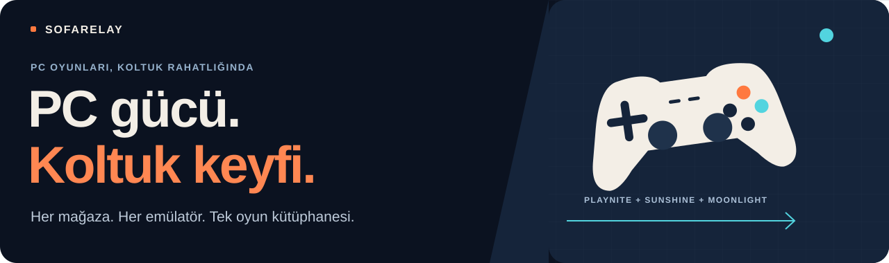

<a href="../../README.md">English</a> &nbsp; · &nbsp; <a href="../../docs/readme/tr.md"><b>Türkçe</b></a> &nbsp; · &nbsp; <a href="../../docs/readme/fr.md">Français</a> &nbsp; · &nbsp; <a href="../../docs/readme/es.md">Español</a>

<h3 align="center">Oyun kütüphanen büyük ekranı hak ediyor.</h3>

Mağazalarını ve emülatörlerini bir araya getir. Kumandayı eline al. Oyun keyfini TV’ye taşı.

  
  &nbsp;
  

  
  
  

<b>Steam &nbsp; / &nbsp; Epic &nbsp; / &nbsp; EA &nbsp; / &nbsp; Ubisoft &nbsp; / &nbsp; Xbox &nbsp; / &nbsp; Retro</b>

---

## Harekete geçerken gör

<a href="../../docs/screenshots/tr/navigation.gif">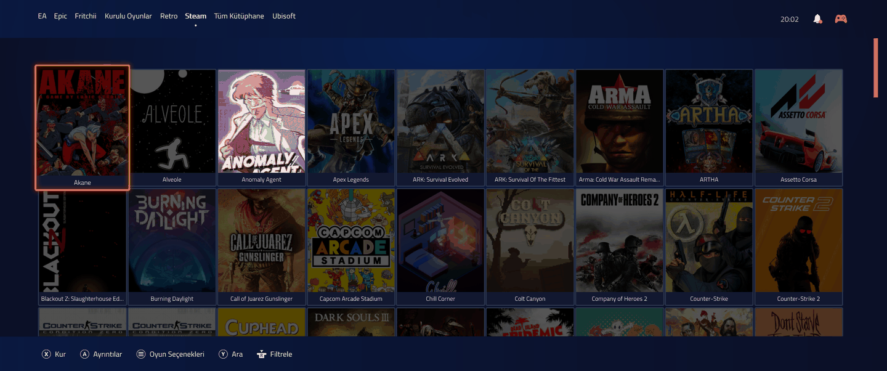</a>

Playnite fullscreen · Steam / Epic / Fritchii · Sunshine + Moonlight

  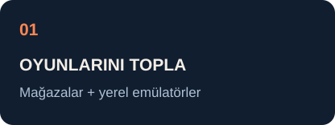
  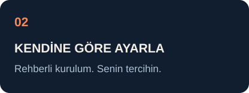
  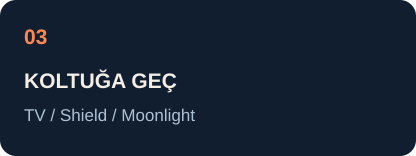

## Arkana yaslan.

| Özellik | Sana kattığı |
| :--- | :--- |
| **Oyunların tek yerde** | Playnite entegrasyonlarıyla Steam, Epic, EA, Ubisoft, isteğe bağlı Xbox ve yerel/emülatör oyunları. |
| **Koltuktan kurulum** | Desteklenen Epic oyunlarında Legendary indirmesi; seçili Steam oyunu için kurulum onayı yardımcısı. Diğer mağazalar kendi istemcisini gerektirebilir. |
| **Geçmişin seninle** | Uyumlu Fritchii/Lichii sürelerini ve RetroArch günlüklerini, çakışan oturumları hesaba katarak aktar. |
| **Kontrol sende** | Kumanda, klavye veya fare. Kütüphanede görünür imleç; oyun içi tuşlar emülatöründe kalır. |
| **Ekran sana uysun** | Kütüphane ve masaüstü kutuları, isteğe bağlı sanal ekran, çözünürlük/Hz ve fiziksel monitörü geri getirme. |
| **Güvenli geri dönüş** | Ayar yedekleri, değişen dosyaları koruyan geri alma, ekran kurtarma kısayolu ve kimliksiz tanı raporu. |

## Oyunların başrolde.

Geliştiricinin bağlı hesaplarından alınmış gerçek kütüphane görüntüleri. TV’ye aktardığın tam ekran arayüzü Playnite sağlıyor.

### Mağazaların bir arada

Kurulmayı bekleyen oyunlar dahil, bağlı kütüphaneni gez.

<a href="../../docs/screenshots/tr/catalog.png">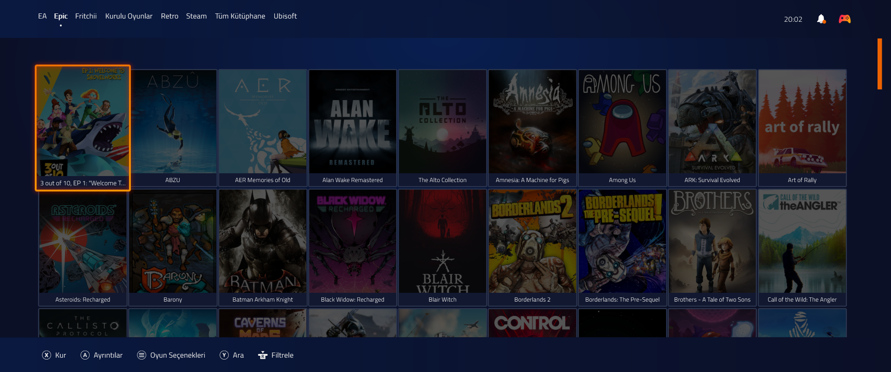</a>

### Oynadığın süre kaybolmasın

Uyumlu emülatör geçmişin oyun ayrıntılarında görünür.

<a href="../../docs/screenshots/tr/game-details.png">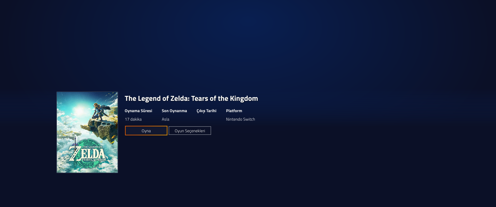</a>

<b>Retro da bu kütüphanede · Koltuktan rahatça gezin</b>

Yerel emülatör oyunların mağaza oyunlarıyla yan yana.

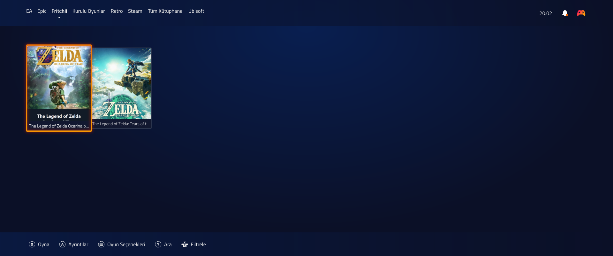

Kütüphane menüleri ve ayarlar elinin altında.

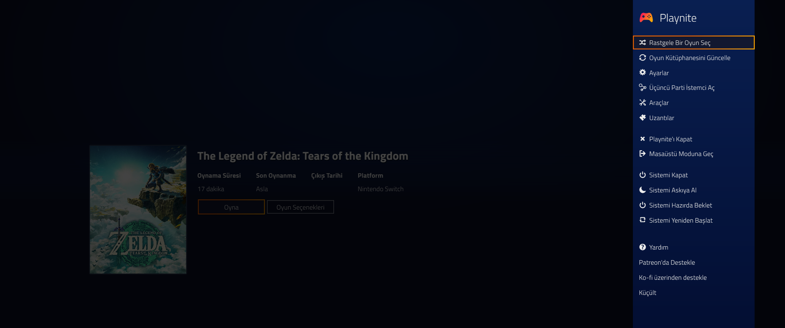

## İndirmeden koltuğa.

1. **İNDİR VE ÇIKAR** — Windows x64 ZIP dosyasının tamamını çıkar. <code>Kurulum.exe</code> dosyasını aç.
2. **BAĞLA VE AYARLA** — Yedi rehberli sayfada mağazalarını, emülatörlerini ve ekran tercihlerini seç. Kendi hesaplarına giriş yap; Moonlight ile Sunshine’ı eşleştir.
3. **EKRANINI SEÇ** — Moonlight’ta kütüphaneyi veya masaüstünü aç. Tercihlerini değiştirmek için ayarlar uygulamasına geri dön.

[Kurulum rehberi](../../docs/guides/tr.md) &nbsp; · &nbsp; Windows 10/11 x64 &nbsp; · &nbsp; TV / NVIDIA Shield / Moonlight

### Senin dilinden anlayan kurulum.

English · Türkçe · Français · Español — kurucu, işlem mesajları ve çevrimdışı yardım dil seçimini izler.

<a href="../../docs/screenshots/tr/page-4.png">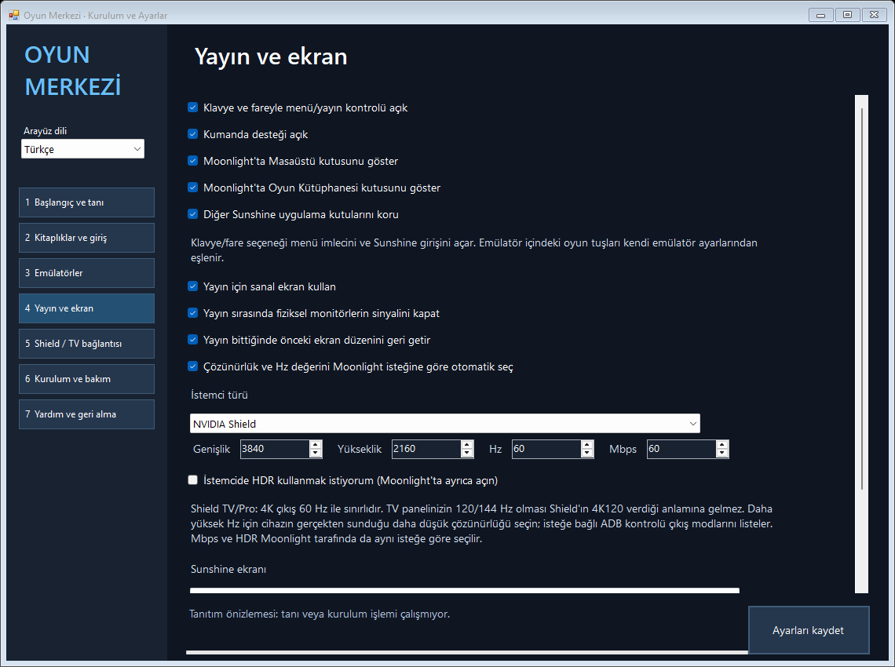</a>

<b>Kurulum ekranlarına göz at</b>

| Kütüphanelerini bağla | TV / Shield eşleştir |
| :---: | :---: |
| 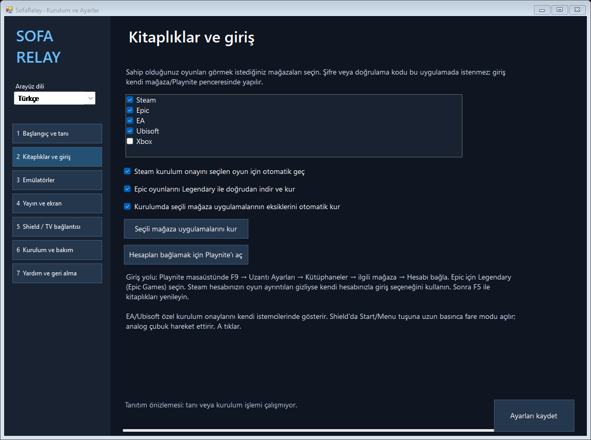 | 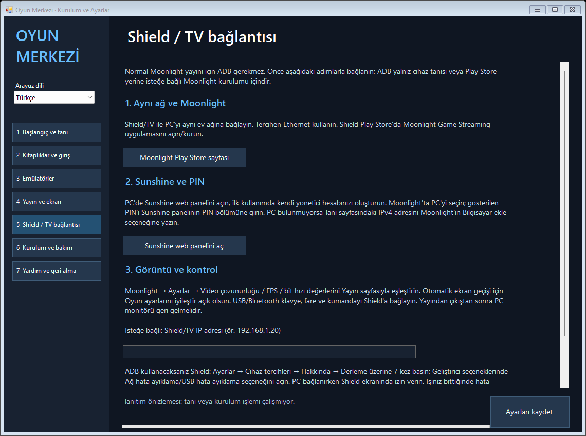 |

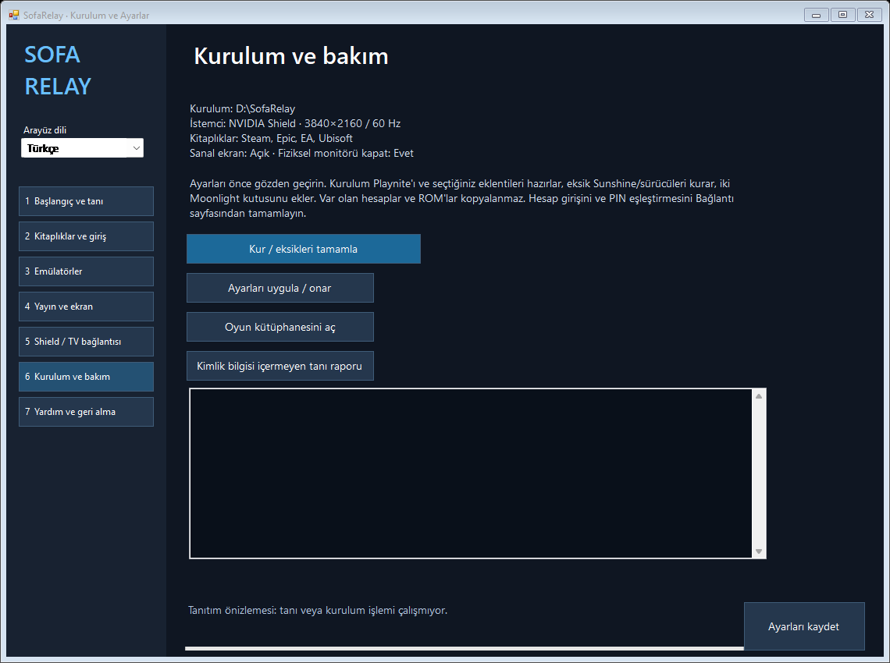

<b>Oyuna geçmeden önce</b>

Windows 10/11 x64, .NET Framework 4.8, PowerShell 5.1, güncel GPU sürücüsü ve Sunshine uyumlu kodlayıcı gerekir. Seçtiğin bileşenler internetten indirilir.

- Shield, Android TV/Google TV ve diğer Moonlight istemcileri kullanılabilir. ADB isteğe bağlıdır.
- Shield’da 4K60 ile başla. Yüksek Hz; istemcinin gerçek çıkışına, kod çözücüsüne, kabloya, PC’ye ve ağa bağlıdır.
- Hesap girişi, iki aşamalı doğrulama ve ilk PIN eşleştirmesini kendi cihazlarında tamamlarsın.
- Bazı mağaza onayları ve ilk kullanım sözleşmeleri kumandanın fare modunu veya mağaza arayüzünü gerektirir.
- Eski süreler için desteklenen günlük ve doğru oyun kimliği gerekir. Oyun, ROM, BIOS, firmware, anahtar, kayıt ve yama dağıtılmaz.

<b>Test kapsamı açık.</b>

15 çekirdek + 45 arka uç + 1.941 yerelleştirme kontrolü, kurucu denetimleri ve gerçek Playnite denemeleri. Fiziksel Shield ve her donanım kombinasyonu test edilmiş değil. [Doğrulama kapsamını oku](../../docs/TESTING.md).

## Güzel projeler. Ortak emek.

Kütüphaneyi Playnite sunuyor. Yayını Sunshine ve Moonlight taşıyor. Game Center bunların etrafına rehberli kurulum, ortak ayarlar, süre aktarımı ve kurtarma araçları ekliyor.

  <a href="https://github.com/JosefNemec/Playnite"><b>Playnite</b></a> &nbsp; + &nbsp;
  <a href="https://github.com/SunshineStream/Sunshine"><b>Sunshine</b></a> &nbsp; + &nbsp;
  <a href="https://github.com/moonlight-stream/moonlight-android"><b>Moonlight</b></a>

VirtualDrivers · Legendary · hawkeye116477 · Libretro · Nefarius · Igor Pavlov · [Bu projeyi mümkün kılanlar](../../docs/CREDITS.md)

## Bir sonraki kurulumu kolaylaştır.

<!-- SUPPORT-LINK:START -->
Yıldız ver, tekrarlanabilir bir hata bildir, çeviriyi iyileştir veya kod katkısı yap. Temel projelerin geliştiricilerini de destekle.
<!-- SUPPORT-LINK:END -->

[Katkıda bulun](../../CONTRIBUTING.md) &nbsp; · &nbsp; [Kaynaktan derle](../../docs/DEVELOPMENT.md) &nbsp; · &nbsp; [Hata bildir](https://github.com/ozi-dev/game-center/issues/new/choose) &nbsp; · &nbsp; [Destek](../../docs/SUPPORT.md)

---

Özgün entegrasyon kodu MIT lisanslıdır. Diğer yazılımlar kendi lisanslarını korur. Görüntülerdeki oyun adları ve kapaklar ilgili hak sahiplerine aittir. <a href="../../THIRD-PARTY.md">Lisanslar ve bildirimler</a>.

Bağımsız bir topluluk projesi. Geliştirici: <a href="https://github.com/ozi-dev"><b>ozi-dev</b></a>.

